# loghub-paradise

Monorepo dos **bridges de entrada (Bridge-IN) do LogHub** e das ferramentas que
os testam. Cada servidor recebe eventos de um protocolo (HTTP, syslog, RELP),
converte cada um num envelope **JLH** do LogHub, guarda-o num **ring** e o
entrega a um **sink**. Os injetores mandam tráfego sintético ou capturado para
esses servidores.

- Cada pasta `go-*` é um **módulo Go independente**. Não existe `go.mod` na
  raiz e nenhum módulo importa outro. O código de mesma origem é copiado e
  portado à mão (ver [`CHANGELOG.md`](CHANGELOG.md)).
- Todos os binários são estáticos (`CGO_ENABLED=0`) e rodam em Linux e macOS,
  amd64 e arm64.
- Cada módulo tem a sua documentação: `docs/SPEC.md` é a fonte da verdade,
  `docs/DECISOES.md` registra o porquê, `docs/TESTING.md` diz o que foi
  provado, e `docker/README.md` cobre a implantação.

## Sumário

1. [Os aplicativos](#1-os-aplicativos)
2. [Como ler os diagramas](#2-como-ler-os-diagramas)
3. [As técnicas, uma por diagrama](#3-as-técnicas-uma-por-diagrama)
4. [Os servidores e suas combinações](#4-os-servidores-e-suas-combinações)
5. [Os injetores, um diagrama por caso](#5-os-injetores-um-diagrama-por-caso)
6. [Como implementar cada sistema](#6-como-implementar-cada-sistema)
7. [Guia de exemplos](#7-guia-de-exemplos)
8. [Versões e releases](#8-versões-e-releases)

---

## 1. Os aplicativos

### Servidores (Bridge-IN)

| Módulo | Recebe | `type` do JLH | Rings | Sinks | Padrão |
|---|---|---|---|---|---|
| [`go-webhook-server`](go-webhook-server/) | HTTP/1.1 e h2c, qualquer caminho e método | `webhook.request` | `memory` `sqlite` `none` | `redis` `sqlite` `postgres` `mysql` `nats` `clickhouse` `none` | memory → redis |
| [`go-webhook-fast-server`](go-webhook-fast-server/) | o mesmo; responde `200` com `stage` | `webhook` (`mode=fast`) | `memory` `sqlite` `none` | `redis` `sqlite` `postgres` `mysql` `nats` `clickhouse` `none` | memory → redis |
| [`go-webhook-pg-server`](go-webhook-pg-server/) | o mesmo do fast | `webhook` | `memory` | `postgres` (`loghub.inbox`) | fixo |
| [`go-webhook-nats-server`](go-webhook-nats-server/) | o mesmo do fast | `webhook` | `memory` | `nats` (`loghub.{space}.webhook`) | fixo |
| [`go-syslog-server`](go-syslog-server/) | syslog UDP, TCP, TLS, unix datagram; PROXY v1/v2 | `syslog` | `memory` `sqlite` `redis` `none` | `nats` `redis` `sqlite` `postgres` `mysql` `clickhouse` `none` | memory → nats |
| [`go-syslog-pg-server`](go-syslog-pg-server/) | syslog UDP, TCP, unix (sem TLS) | `syslog` | `memory` | `postgres` (`loghub.inbox`) | fixo |
| [`go-syslog-nats-server`](go-syslog-nats-server/) | syslog UDP, TCP, unix (sem TLS) | `syslog` | `memory` | `nats` (`loghub.{space}.syslog`) | fixo |
| [`go-relplog-server`](go-relplog-server/) | RELP (`omrelp` do rsyslog) em claro ou TLS; PROXY v1/v2 | `syslog` + `x-transport: relp` | `memory` `sqlite` `redis` `none` | `nats` `redis` `sqlite` `postgres` `mysql` `clickhouse` `none` | memory → nats |
| [`go-relplog-pg-server`](go-relplog-pg-server/) | RELP em claro | `syslog` + `x-transport: relp` | `memory` | `postgres` (`loghub.inbox`) | fixo |
| [`go-relplog-nats-server`](go-relplog-nats-server/) | RELP em claro | `syslog` + `x-transport: relp` | `memory` | `nats` (`loghub.{space}.syslog`) | fixo |
| [`go-syslog-standard-server`](go-syslog-standard-server/) | syslog UDP, TCP, TLS, unix, RELP | — (formato próprio) | `memory` `sqlite` `none` | `redis` `sqlite` `postgres` `mysql` `nats` `none` | memory → redis |

Os nomes "pg" e "nats" indicam **cortes**. Um corte é um servidor reduzido a
um ring (`memory`) e um destino. Tem poucas dependências (três em produção),
não tem TLS e faz o dump de emergência em JSON Lines. O
`go-syslog-standard-server` é o servidor syslog antigo, anterior ao LogHub.
Fica no repositório como referência de código, não como produto.

### Ferramentas cliente (injetores)

| Módulo | Fala com | Transportes | Conteúdo |
|---|---|---|---|
| [`go-syslog-injector`](go-syslog-injector/) | `go-syslog-server`, cortes e qualquer servidor syslog | UDP, TCP (octet-counting ou LF), TLS/mTLS, unix datagram; PROXY v1/v2 | gerador `seq=N`, modelo com marcadores, arquivo/stdin, **replay de pcap/pcapng** |
| [`go-relplog-injector`](go-relplog-injector/) | `go-relplog-server`, cortes e qualquer `imrelp` | sessão RELP em TCP ou TLS/mTLS; PROXY v1/v2; janela, confirmação por mensagem, retransmissão | os mesmos, com replay de RELP, syslog TCP ou UDP capturados |
| [`go-webhook-injector`](go-webhook-injector/) | `go-webhook-server`, `go-webhook-fast-server`, cortes e qualquer servidor HTTP | HTTP/1.1 keep-alive com **pipelining**; HTTP/2 (h2c ou ALPN) com muitos streams; TLS/mTLS; reenvio de `429`/`503` | gerador JSON com `seq`, modelo com marcadores (corpo, URL, cabeçalhos), arquivo/stdin/pasta, **replay de requisições HTTP de pcap/pcapng** |

Os injetores servem para teste funcional e de carga. Aceitam `--count`,
`--duration`, `--rate` e `--concurrency`. Ao fim imprimem um relatório (texto
ou JSON) com desfechos, vazão e latência. O código de saída diz o resultado:
`0` ok, `1` alguma falha, `2` uso, `3` alvo inalcançável, `130` interrompido.
Não têm dependência fora da biblioteca padrão.

### Que injetor usar com cada servidor

Cada servidor tem um injetor que fala o protocolo dele, provado contra o
servidor real (números em `docs/TESTING.md` de cada injetor):

| Servidor | Injetor | Carga extrema medida (Mac M2, mesma máquina) |
|---|---|---|
| `go-webhook-server` | `go-webhook-injector` | ~165 mil req/s com pipelining; 1,58 milhão gravadas no SQLite, conferidas |
| `go-webhook-fast-server` | `go-webhook-injector` | ~169 mil req/s |
| `go-webhook-pg-server` | `go-webhook-injector` | 200 mil, cada `X-LogHub-UUID` achado na `loghub.inbox` |
| `go-webhook-nats-server` | `go-webhook-injector` | 300 mil por HTTP/2, 300 mil no stream JetStream |
| `go-syslog-server` | `go-syslog-injector` | ~1 milhão de msg/s por TCP |
| `go-syslog-pg-server`, `go-syslog-nats-server` | `go-syslog-injector` | (mesmo protocolo do `go-syslog-server`, sem TLS) |
| `go-syslog-standard-server` | `go-syslog-injector` (syslog) ou `go-relplog-injector` (RELP) | — |
| `go-relplog-server` | `go-relplog-injector` | ~510 mil msg/s confirmadas uma a uma |
| `go-relplog-pg-server`, `go-relplog-nats-server` | `go-relplog-injector` | (mesmo protocolo do `go-relplog-server`, sem TLS) |

---

## 2. Como ler os diagramas

Cada diagrama mostra **um caso só**, da esquerda para a direita:

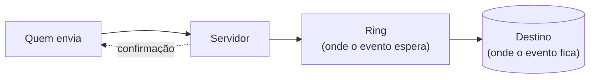

- **Retângulo:** um programa ou um passo.
- **Cilindro:** um lugar onde o evento fica gravado (banco, fila, arquivo).
- **Seta cheia:** o caminho do evento.
- **Seta tracejada:** a resposta que volta para quem enviou.

Os nomes **ring** e **sink** aparecem em todo o README:

- **Ring** é a sala de espera: o evento fica ali entre ser aceito e ser entregue.
- **Sink** é o destino final: o banco ou a fila onde o evento fica guardado.

## 3. As técnicas, uma por diagrama

Cada técnica usada pelos servidores, explicada sozinha.

### 3.1 O que todo servidor faz

Recebe o evento, transforma num envelope JLH do LogHub, guarda no ring e entrega ao destino.

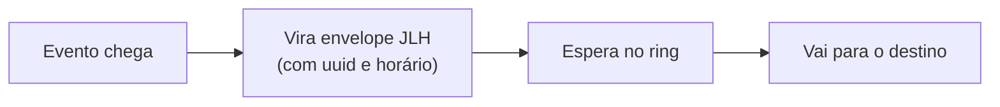

### 3.2 Ring memory: espera na RAM

É o ring mais rápido. O evento é confirmado assim que entra na memória.

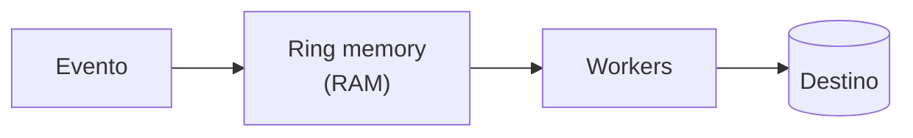

Se o processo morrer de repente, o que estava na RAM se perde. No desligamento normal, o dump de emergência (3.6) salva o que não deu tempo de entregar.

### 3.3 Ring sqlite: espera no disco

O evento só é confirmado depois de gravado no arquivo `ring.db`, com `fsync`. Nada se perde numa queda.

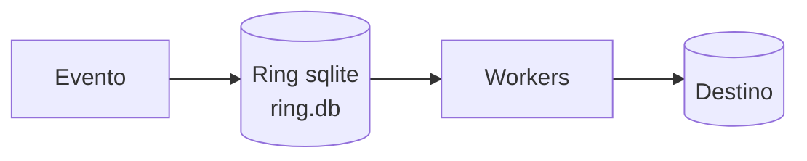

Depois que o destino confirma, a linha sai do `ring.db`:

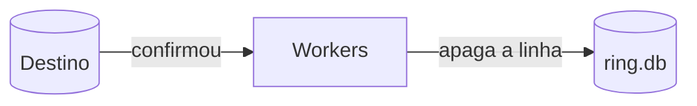

### 3.4 Ring redis: espera compartilhada entre réplicas

Só nos servidores de syslog e RELP completos (`go-syslog-server`, `go-relplog-server`). Várias réplicas gravam no mesmo stream Redis.

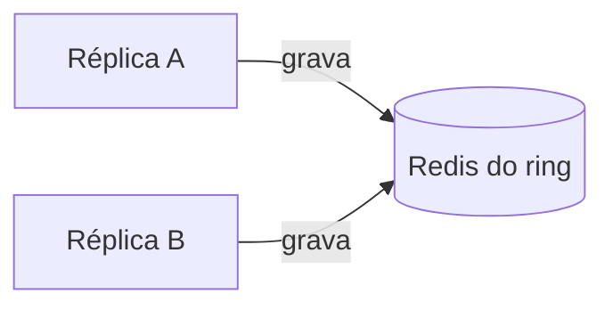

Qualquer réplica pode entregar o que outra recebeu. Se a réplica A cair, a B termina o trabalho:

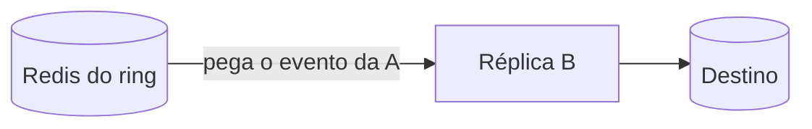

Todas as réplicas precisam da mesma configuração `[syslog]`, do mesmo `WORKSPACE` e da mesma versão.

### 3.5 Ring none: sem espera

Não há ring. O servidor grava direto no destino e só responde depois disso. Se o destino falhar, quem enviou fica sabendo (no HTTP, recebe um `5xx` e reenvia).

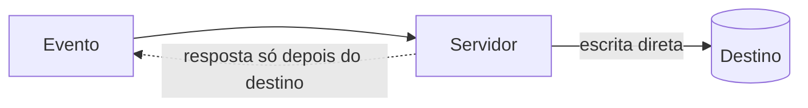

### 3.6 Dump de emergência

Com ring memory, no desligamento (`SIGTERM`) o servidor tenta entregar tudo. O que não couber no prazo vai para um arquivo em `emergency/`.

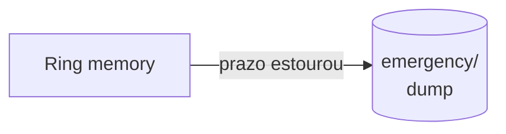

No próximo boot, o servidor lê o dump e entrega ao destino:

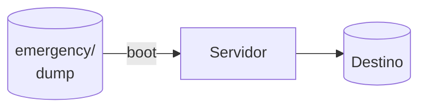

Nos cortes (`*-pg-server`, `*-nats-server`) o dump é em JSON Lines (`.jsonl`).

### 3.7 Workers e lotes

Os workers tiram eventos do ring em lotes e mandam cada lote ao destino de uma vez.

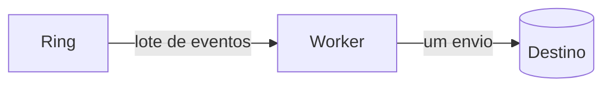

Se o destino falhar, o worker segura o lote e tenta de novo. O evento só sai do ring depois da confirmação.

### 3.8 HTTP: a resposta 200

Nos servidores de webhook, o `200 OK` só sai depois da garantia da combinação ring × sink. O cabeçalho `X-LogHub-UUID` traz o identificador do evento.

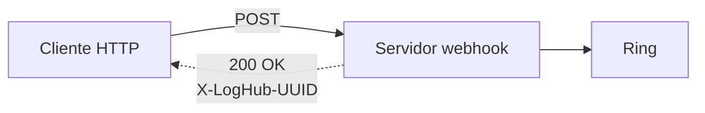

### 3.9 HTTP: ring cheio responde 429

Se o ring encher, o servidor recusa com `429` e `Retry-After`. Nunca responde `200` para depois descartar.

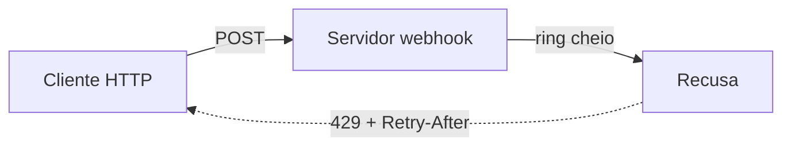

### 3.10 HTTP: IP de origem atrás de proxy

Só um proxy listado em `proxy.trusted` pode informar o IP real do cliente pelo `X-Forwarded-For`.

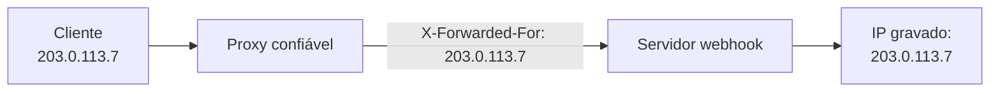

Um cliente que manda o cabeçalho direto é ignorado; vale o IP da conexão:

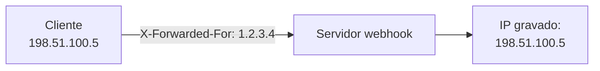

### 3.11 Syslog TCP e TLS: o servidor para de ler

Syslog por TCP não tem resposta. Com o ring cheio, o servidor simplesmente para de ler a conexão, e a janela TCP faz o emissor esperar.

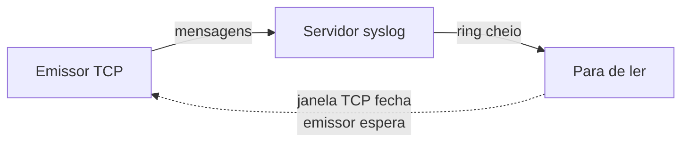

### 3.12 Syslog UDP: descarte contado

UDP não tem confirmação nem como segurar o emissor. Com o ring cheio, a mensagem é descartada e contada na métrica `syslog_messages_dropped_total`.

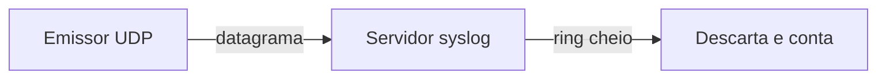

### 3.13 Syslog: cru no ring, conversão na saída

No syslog, o ring guarda a mensagem crua. A conversão para JLH acontece no worker, na hora de entregar.

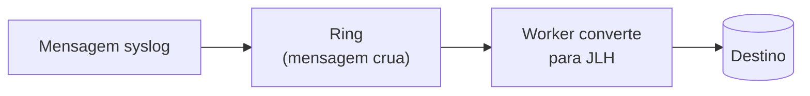

Nos webhooks é o contrário: o JLH é escrito uma vez, na chegada, e o ring guarda o envelope pronto:

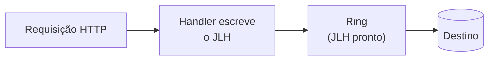

### 3.14 PROXY protocol

Um balanceador na frente do servidor syslog ou RELP pode anunciar a origem real com o cabeçalho PROXY v1 ou v2.

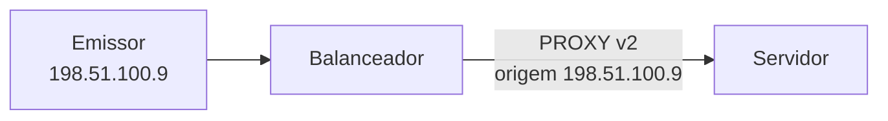

### 3.15 RELP: uma confirmação por mensagem

No RELP cada mensagem tem um número de transação. O servidor responde `200 OK` para aquele número só depois que a mensagem está no ring.

```mermaid
flowchart LR
    A["rsyslog"] -->|"txnr 7: mensagem"| B["Servidor RELP"]
    B --> R["Ring"]
    B -.->|"txnr 7: 200 OK"| A
```

### 3.16 RELP: servidor ocupado

Com o ring cheio ou o destino fora, o servidor segura a transação. Passado `relp.backpressure_timeout` (30 s), fecha a sessão sem responder.

```mermaid
flowchart LR
    A["rsyslog"] -->|"mensagem"| B["Servidor RELP"]
    B -->|"30 s sem espaço"| X["Fecha a sessão<br/>sem responder"]
```

O rsyslog reconecta e reenvia o que ficou sem resposta. Nada se perde:

```mermaid
flowchart LR
    A["rsyslog"] -->|"reconecta e reenvia"| B["Servidor RELP"]
    B -.->|"200 OK"| A
```

### 3.17 NATS: publicação confirmada

Com `sink=nats` em modo JetStream, cada publicação recebe um `PubAck`. O `uuid` do evento vai como `Nats-Msg-Id`, e o stream descarta repetições.

```mermaid
flowchart LR
    W["Worker"] -->|"publica<br/>Nats-Msg-Id = uuid"| J[("JetStream")]
    J -.->|"PubAck"| W
```

### 3.18 NATS: heartbeat beacon

Os servidores com NATS anunciam que estão vivos em `loghub._ctl.beacon`.

```mermaid
flowchart LR
    B["Servidor"] -->|"a cada intervalo"| C[("loghub._ctl.beacon")]
```

### 3.19 Ring redis com sink redis: não pode

Nos servidores de syslog e RELP, pedir ring redis com destino redis faz o servidor usar ring memory e avisar no log. Um ring no mesmo Redis do destino não protegeria nada.

```mermaid
flowchart LR
    C["ring=redis<br/>sink=redis"] -->|"no boot"| M["vira ring=memory<br/>+ aviso"]
```

### 3.20 O servidor nunca cria o esquema

Tabelas e streams são criados por você antes. O servidor só confere no boot e, se algo estiver errado, sai com código `3`.

```mermaid
flowchart LR
    B["Servidor sobe"] --> V{"Tabela ou stream<br/>está certo?"}
    V -->|"sim"| OK["Começa a receber"]
    V -->|"não"| X["Sai com código 3"]
```

### 3.21 Sink nats: NATS JetStream

Um barramento de mensagens. Outros programas assinam o subject e recebem os eventos.

```mermaid
flowchart LR
    W["Worker"] --> D[("NATS JetStream<br/>loghub.{space}.{type}")]
```

### 3.22 Sink redis: Redis Streams

Uma fila no Redis (`XADD`). Padrão da família webhook.

```mermaid
flowchart LR
    W["Worker"] --> D[("Redis Streams")]
```

### 3.23 Sink sqlite: SQLite

Um arquivo local, só para acrescentar. Bom para um nó único sem infraestrutura.

```mermaid
flowchart LR
    W["Worker"] --> D[("SQLite<br/>events.db")]
```

### 3.24 Sink postgres: PostgreSQL

A fila `loghub.inbox` do LogHub. Várias instâncias podem gravar na mesma tabela.

```mermaid
flowchart LR
    W["Worker"] --> D[("PostgreSQL<br/>loghub.inbox")]
```

### 3.25 Sink mysql: MySQL

Uma tabela `inbox` igual à do PostgreSQL.

```mermaid
flowchart LR
    W["Worker"] --> D[("MySQL<br/>tabela inbox")]
```

### 3.26 Sink clickhouse: ClickHouse

Um banco analítico para consultar o histórico.

```mermaid
flowchart LR
    W["Worker"] --> D[("ClickHouse<br/>inbox ou inbox_syslog")]
```

### 3.27 Sink none: none

Não grava nada. Serve só para medir desempenho; o servidor avisa no boot.

```mermaid
flowchart LR
    W["Worker"] --> D["Descarte"]
```

## 4. Os servidores e suas combinações

Cada servidor tem a sua seção. Primeiro, um diagrama do servidor sozinho; depois, um diagrama para cada combinação de ring e sink que ele aceita. A combinação padrão está marcada com ★.

### 4.1 go-webhook-server

Recebe webhooks por HTTP/1.1 e h2c, em qualquer caminho e método, e grava cada requisição como um evento JLH `type=webhook.request`.

```mermaid
flowchart LR
    A["Cliente HTTP"] --> B["go-webhook-server"]
    B --> R["Ring"]
    R --> D[("Destino")]
```

Rings: `memory`, `sqlite`, `none`. Sinks: `redis`, `sqlite`, `postgres`, `mysql`, `nats`, `clickhouse`, `none`.

#### go-webhook-server: ring memory → sink Redis ★

```mermaid
flowchart LR
    A["Cliente HTTP"] --> B["go-webhook-server"]
    B --> R["Ring memory<br/>(na RAM)"]
    R --> D[("Redis Streams<br/>loghub.{space}.webhook.request")]
    B -.->|"200 OK"| A
```

- **Confirmação ao emissor:** quando o evento está na RAM.
- **Perda se o servidor cair de repente:** o que estava na RAM; o dump de emergência salva o que conseguir.

#### go-webhook-server: ring memory → sink SQLite

```mermaid
flowchart LR
    A["Cliente HTTP"] --> B["go-webhook-server"]
    B --> R["Ring memory<br/>(na RAM)"]
    R --> D[("SQLite<br/>events.db")]
    B -.->|"200 OK"| A
```

- **Confirmação ao emissor:** quando o evento está na RAM.
- **Perda se o servidor cair de repente:** o que estava na RAM; o dump de emergência salva o que conseguir.

#### go-webhook-server: ring memory → sink PostgreSQL

```mermaid
flowchart LR
    A["Cliente HTTP"] --> B["go-webhook-server"]
    B --> R["Ring memory<br/>(na RAM)"]
    R --> D[("PostgreSQL<br/>loghub.inbox")]
    B -.->|"200 OK"| A
```

- **Confirmação ao emissor:** quando o evento está na RAM.
- **Perda se o servidor cair de repente:** o que estava na RAM; o dump de emergência salva o que conseguir.

#### go-webhook-server: ring memory → sink MySQL

```mermaid
flowchart LR
    A["Cliente HTTP"] --> B["go-webhook-server"]
    B --> R["Ring memory<br/>(na RAM)"]
    R --> D[("MySQL<br/>tabela inbox")]
    B -.->|"200 OK"| A
```

- **Confirmação ao emissor:** quando o evento está na RAM.
- **Perda se o servidor cair de repente:** o que estava na RAM; o dump de emergência salva o que conseguir.

#### go-webhook-server: ring memory → sink NATS

```mermaid
flowchart LR
    A["Cliente HTTP"] --> B["go-webhook-server"]
    B --> R["Ring memory<br/>(na RAM)"]
    R --> D[("NATS JetStream<br/>loghub.{space}.webhook.request")]
    B -.->|"200 OK"| A
```

- **Confirmação ao emissor:** quando o evento está na RAM.
- **Perda se o servidor cair de repente:** o que estava na RAM; o dump de emergência salva o que conseguir.

#### go-webhook-server: ring memory → sink ClickHouse

```mermaid
flowchart LR
    A["Cliente HTTP"] --> B["go-webhook-server"]
    B --> R["Ring memory<br/>(na RAM)"]
    R --> D[("ClickHouse<br/>tabela inbox")]
    B -.->|"200 OK"| A
```

- **Confirmação ao emissor:** quando o evento está na RAM.
- **Perda se o servidor cair de repente:** o que estava na RAM; o dump de emergência salva o que conseguir.

#### go-webhook-server: ring memory → sink none (descarte)

```mermaid
flowchart LR
    A["Cliente HTTP"] --> B["go-webhook-server"]
    B --> R["Ring memory<br/>(na RAM)"]
    R --> D["Descarte<br/>(só benchmark)"]
    B -.->|"200 OK"| A
```

- **Confirmação ao emissor:** quando o evento está na RAM.
- **Perda se o servidor cair de repente:** o que estava na RAM; o dump de emergência salva o que conseguir.
- **Uso:** só para medir desempenho. O evento nunca é guardado.

#### go-webhook-server: ring sqlite → sink Redis

```mermaid
flowchart LR
    A["Cliente HTTP"] --> B["go-webhook-server"]
    B --> R[("Ring sqlite<br/>ring.db em disco")]
    R --> D[("Redis Streams<br/>loghub.{space}.webhook.request")]
    B -.->|"200 OK"| A
```

- **Confirmação ao emissor:** quando o evento está gravado no disco (fsync).
- **Perda se o servidor cair de repente:** nada.

#### go-webhook-server: ring sqlite → sink SQLite

```mermaid
flowchart LR
    A["Cliente HTTP"] --> B["go-webhook-server"]
    B --> R[("Ring sqlite<br/>ring.db em disco")]
    R --> D[("SQLite<br/>events.db")]
    B -.->|"200 OK"| A
```

- **Confirmação ao emissor:** quando o evento está gravado no disco (fsync).
- **Perda se o servidor cair de repente:** nada.
- **Atenção:** `ring.db` e `events.db` precisam ser arquivos diferentes, de preferência em discos diferentes.

#### go-webhook-server: ring sqlite → sink PostgreSQL

```mermaid
flowchart LR
    A["Cliente HTTP"] --> B["go-webhook-server"]
    B --> R[("Ring sqlite<br/>ring.db em disco")]
    R --> D[("PostgreSQL<br/>loghub.inbox")]
    B -.->|"200 OK"| A
```

- **Confirmação ao emissor:** quando o evento está gravado no disco (fsync).
- **Perda se o servidor cair de repente:** nada.

#### go-webhook-server: ring sqlite → sink MySQL

```mermaid
flowchart LR
    A["Cliente HTTP"] --> B["go-webhook-server"]
    B --> R[("Ring sqlite<br/>ring.db em disco")]
    R --> D[("MySQL<br/>tabela inbox")]
    B -.->|"200 OK"| A
```

- **Confirmação ao emissor:** quando o evento está gravado no disco (fsync).
- **Perda se o servidor cair de repente:** nada.

#### go-webhook-server: ring sqlite → sink NATS

```mermaid
flowchart LR
    A["Cliente HTTP"] --> B["go-webhook-server"]
    B --> R[("Ring sqlite<br/>ring.db em disco")]
    R --> D[("NATS JetStream<br/>loghub.{space}.webhook.request")]
    B -.->|"200 OK"| A
```

- **Confirmação ao emissor:** quando o evento está gravado no disco (fsync).
- **Perda se o servidor cair de repente:** nada.

#### go-webhook-server: ring sqlite → sink ClickHouse

```mermaid
flowchart LR
    A["Cliente HTTP"] --> B["go-webhook-server"]
    B --> R[("Ring sqlite<br/>ring.db em disco")]
    R --> D[("ClickHouse<br/>tabela inbox")]
    B -.->|"200 OK"| A
```

- **Confirmação ao emissor:** quando o evento está gravado no disco (fsync).
- **Perda se o servidor cair de repente:** nada.

#### go-webhook-server: ring sqlite → sink none (descarte)

```mermaid
flowchart LR
    A["Cliente HTTP"] --> B["go-webhook-server"]
    B --> R[("Ring sqlite<br/>ring.db em disco")]
    R --> D["Descarte<br/>(só benchmark)"]
    B -.->|"200 OK"| A
```

- **Confirmação ao emissor:** quando o evento está gravado no disco (fsync).
- **Perda se o servidor cair de repente:** nada.
- **Uso:** só para medir desempenho. O evento nunca é guardado.

#### go-webhook-server: ring none → sink Redis

```mermaid
flowchart LR
    A["Cliente HTTP"] --> B["go-webhook-server"]
    B -->|"escrita direta"| D[("Redis Streams<br/>loghub.{space}.webhook.request")]
    B -.->|"200 OK"| A
```

- **Confirmação ao emissor:** depois do XADD confirmado pelo Redis.
- **Perda se o servidor cair de repente:** nada.

#### go-webhook-server: ring none → sink SQLite

```mermaid
flowchart LR
    A["Cliente HTTP"] --> B["go-webhook-server"]
    B -->|"escrita direta"| D[("SQLite<br/>events.db")]
    B -.->|"200 OK"| A
```

- **Confirmação ao emissor:** depois do COMMIT no events.db.
- **Perda se o servidor cair de repente:** nada.

#### go-webhook-server: ring none → sink PostgreSQL

```mermaid
flowchart LR
    A["Cliente HTTP"] --> B["go-webhook-server"]
    B -->|"escrita direta"| D[("PostgreSQL<br/>loghub.inbox")]
    B -.->|"200 OK"| A
```

- **Confirmação ao emissor:** depois do INSERT confirmado pelo PostgreSQL.
- **Perda se o servidor cair de repente:** nada.

#### go-webhook-server: ring none → sink MySQL

```mermaid
flowchart LR
    A["Cliente HTTP"] --> B["go-webhook-server"]
    B -->|"escrita direta"| D[("MySQL<br/>tabela inbox")]
    B -.->|"200 OK"| A
```

- **Confirmação ao emissor:** depois do INSERT confirmado pelo MySQL.
- **Perda se o servidor cair de repente:** nada.

#### go-webhook-server: ring none → sink NATS

```mermaid
flowchart LR
    A["Cliente HTTP"] --> B["go-webhook-server"]
    B -->|"escrita direta"| D[("NATS JetStream<br/>loghub.{space}.webhook.request")]
    B -.->|"200 OK"| A
```

- **Confirmação ao emissor:** depois do PubAck do JetStream.
- **Perda se o servidor cair de repente:** nada.

#### go-webhook-server: ring none → sink ClickHouse

```mermaid
flowchart LR
    A["Cliente HTTP"] --> B["go-webhook-server"]
    B -->|"escrita direta"| D[("ClickHouse<br/>tabela inbox")]
    B -.->|"200 OK"| A
```

- **Confirmação ao emissor:** depois do INSERT respondido pelo ClickHouse.
- **Perda se o servidor cair de repente:** nada.
- **Atenção:** cada requisição vira uma parte no ClickHouse; use só com `async_insert` no perfil do usuário.

#### go-webhook-server: ring none → sink none (descarte)

```mermaid
flowchart LR
    A["Cliente HTTP"] --> B["go-webhook-server"]
    B -->|"escrita direta"| D["Descarte<br/>(só benchmark)"]
    B -.->|"200 OK"| A
```

- **Confirmação ao emissor:** na hora, e o evento é descartado.
- **Perda se o servidor cair de repente:** tudo.
- **Uso:** só para medir desempenho. O evento nunca é guardado.

### 4.2 go-webhook-fast-server

Igual ao `go-webhook-server`, mas grava `type=webhook` (`mode=fast`) e a resposta diz em que estágio o evento estava (`stage`).

```mermaid
flowchart LR
    A["Cliente HTTP"] --> B["go-webhook-fast-server"]
    B --> R["Ring"]
    R --> D[("Destino")]
```

Rings: `memory`, `sqlite`, `none`. Sinks: `redis`, `sqlite`, `postgres`, `mysql`, `nats`, `clickhouse`, `none`.

#### go-webhook-fast-server: ring memory → sink Redis ★

```mermaid
flowchart LR
    A["Cliente HTTP"] --> B["go-webhook-fast-server"]
    B --> R["Ring memory<br/>(na RAM)"]
    R --> D[("Redis Streams<br/>loghub.{space}.webhook")]
    B -.->|"200 OK + stage"| A
```

- **Confirmação ao emissor:** quando o evento está na RAM.
- **Perda se o servidor cair de repente:** o que estava na RAM; o dump de emergência salva o que conseguir.

#### go-webhook-fast-server: ring memory → sink SQLite

```mermaid
flowchart LR
    A["Cliente HTTP"] --> B["go-webhook-fast-server"]
    B --> R["Ring memory<br/>(na RAM)"]
    R --> D[("SQLite<br/>events.db")]
    B -.->|"200 OK + stage"| A
```

- **Confirmação ao emissor:** quando o evento está na RAM.
- **Perda se o servidor cair de repente:** o que estava na RAM; o dump de emergência salva o que conseguir.

#### go-webhook-fast-server: ring memory → sink PostgreSQL

```mermaid
flowchart LR
    A["Cliente HTTP"] --> B["go-webhook-fast-server"]
    B --> R["Ring memory<br/>(na RAM)"]
    R --> D[("PostgreSQL<br/>loghub.inbox")]
    B -.->|"200 OK + stage"| A
```

- **Confirmação ao emissor:** quando o evento está na RAM.
- **Perda se o servidor cair de repente:** o que estava na RAM; o dump de emergência salva o que conseguir.

#### go-webhook-fast-server: ring memory → sink MySQL

```mermaid
flowchart LR
    A["Cliente HTTP"] --> B["go-webhook-fast-server"]
    B --> R["Ring memory<br/>(na RAM)"]
    R --> D[("MySQL<br/>tabela inbox")]
    B -.->|"200 OK + stage"| A
```

- **Confirmação ao emissor:** quando o evento está na RAM.
- **Perda se o servidor cair de repente:** o que estava na RAM; o dump de emergência salva o que conseguir.

#### go-webhook-fast-server: ring memory → sink NATS

```mermaid
flowchart LR
    A["Cliente HTTP"] --> B["go-webhook-fast-server"]
    B --> R["Ring memory<br/>(na RAM)"]
    R --> D[("NATS JetStream<br/>loghub.{space}.webhook")]
    B -.->|"200 OK + stage"| A
```

- **Confirmação ao emissor:** quando o evento está na RAM.
- **Perda se o servidor cair de repente:** o que estava na RAM; o dump de emergência salva o que conseguir.

#### go-webhook-fast-server: ring memory → sink ClickHouse

```mermaid
flowchart LR
    A["Cliente HTTP"] --> B["go-webhook-fast-server"]
    B --> R["Ring memory<br/>(na RAM)"]
    R --> D[("ClickHouse<br/>tabela inbox")]
    B -.->|"200 OK + stage"| A
```

- **Confirmação ao emissor:** quando o evento está na RAM.
- **Perda se o servidor cair de repente:** o que estava na RAM; o dump de emergência salva o que conseguir.

#### go-webhook-fast-server: ring memory → sink none (descarte)

```mermaid
flowchart LR
    A["Cliente HTTP"] --> B["go-webhook-fast-server"]
    B --> R["Ring memory<br/>(na RAM)"]
    R --> D["Descarte<br/>(só benchmark)"]
    B -.->|"200 OK + stage"| A
```

- **Confirmação ao emissor:** quando o evento está na RAM.
- **Perda se o servidor cair de repente:** o que estava na RAM; o dump de emergência salva o que conseguir.
- **Uso:** só para medir desempenho. O evento nunca é guardado.

#### go-webhook-fast-server: ring sqlite → sink Redis

```mermaid
flowchart LR
    A["Cliente HTTP"] --> B["go-webhook-fast-server"]
    B --> R[("Ring sqlite<br/>ring.db em disco")]
    R --> D[("Redis Streams<br/>loghub.{space}.webhook")]
    B -.->|"200 OK + stage"| A
```

- **Confirmação ao emissor:** quando o evento está gravado no disco (fsync).
- **Perda se o servidor cair de repente:** nada.

#### go-webhook-fast-server: ring sqlite → sink SQLite

```mermaid
flowchart LR
    A["Cliente HTTP"] --> B["go-webhook-fast-server"]
    B --> R[("Ring sqlite<br/>ring.db em disco")]
    R --> D[("SQLite<br/>events.db")]
    B -.->|"200 OK + stage"| A
```

- **Confirmação ao emissor:** quando o evento está gravado no disco (fsync).
- **Perda se o servidor cair de repente:** nada.
- **Atenção:** `ring.db` e `events.db` precisam ser arquivos diferentes, de preferência em discos diferentes.

#### go-webhook-fast-server: ring sqlite → sink PostgreSQL

```mermaid
flowchart LR
    A["Cliente HTTP"] --> B["go-webhook-fast-server"]
    B --> R[("Ring sqlite<br/>ring.db em disco")]
    R --> D[("PostgreSQL<br/>loghub.inbox")]
    B -.->|"200 OK + stage"| A
```

- **Confirmação ao emissor:** quando o evento está gravado no disco (fsync).
- **Perda se o servidor cair de repente:** nada.

#### go-webhook-fast-server: ring sqlite → sink MySQL

```mermaid
flowchart LR
    A["Cliente HTTP"] --> B["go-webhook-fast-server"]
    B --> R[("Ring sqlite<br/>ring.db em disco")]
    R --> D[("MySQL<br/>tabela inbox")]
    B -.->|"200 OK + stage"| A
```

- **Confirmação ao emissor:** quando o evento está gravado no disco (fsync).
- **Perda se o servidor cair de repente:** nada.

#### go-webhook-fast-server: ring sqlite → sink NATS

```mermaid
flowchart LR
    A["Cliente HTTP"] --> B["go-webhook-fast-server"]
    B --> R[("Ring sqlite<br/>ring.db em disco")]
    R --> D[("NATS JetStream<br/>loghub.{space}.webhook")]
    B -.->|"200 OK + stage"| A
```

- **Confirmação ao emissor:** quando o evento está gravado no disco (fsync).
- **Perda se o servidor cair de repente:** nada.

#### go-webhook-fast-server: ring sqlite → sink ClickHouse

```mermaid
flowchart LR
    A["Cliente HTTP"] --> B["go-webhook-fast-server"]
    B --> R[("Ring sqlite<br/>ring.db em disco")]
    R --> D[("ClickHouse<br/>tabela inbox")]
    B -.->|"200 OK + stage"| A
```

- **Confirmação ao emissor:** quando o evento está gravado no disco (fsync).
- **Perda se o servidor cair de repente:** nada.

#### go-webhook-fast-server: ring sqlite → sink none (descarte)

```mermaid
flowchart LR
    A["Cliente HTTP"] --> B["go-webhook-fast-server"]
    B --> R[("Ring sqlite<br/>ring.db em disco")]
    R --> D["Descarte<br/>(só benchmark)"]
    B -.->|"200 OK + stage"| A
```

- **Confirmação ao emissor:** quando o evento está gravado no disco (fsync).
- **Perda se o servidor cair de repente:** nada.
- **Uso:** só para medir desempenho. O evento nunca é guardado.

#### go-webhook-fast-server: ring none → sink Redis

```mermaid
flowchart LR
    A["Cliente HTTP"] --> B["go-webhook-fast-server"]
    B -->|"escrita direta"| D[("Redis Streams<br/>loghub.{space}.webhook")]
    B -.->|"200 OK + stage"| A
```

- **Confirmação ao emissor:** depois do XADD confirmado pelo Redis.
- **Perda se o servidor cair de repente:** nada.

#### go-webhook-fast-server: ring none → sink SQLite

```mermaid
flowchart LR
    A["Cliente HTTP"] --> B["go-webhook-fast-server"]
    B -->|"escrita direta"| D[("SQLite<br/>events.db")]
    B -.->|"200 OK + stage"| A
```

- **Confirmação ao emissor:** depois do COMMIT no events.db.
- **Perda se o servidor cair de repente:** nada.

#### go-webhook-fast-server: ring none → sink PostgreSQL

```mermaid
flowchart LR
    A["Cliente HTTP"] --> B["go-webhook-fast-server"]
    B -->|"escrita direta"| D[("PostgreSQL<br/>loghub.inbox")]
    B -.->|"200 OK + stage"| A
```

- **Confirmação ao emissor:** depois do INSERT confirmado pelo PostgreSQL.
- **Perda se o servidor cair de repente:** nada.

#### go-webhook-fast-server: ring none → sink MySQL

```mermaid
flowchart LR
    A["Cliente HTTP"] --> B["go-webhook-fast-server"]
    B -->|"escrita direta"| D[("MySQL<br/>tabela inbox")]
    B -.->|"200 OK + stage"| A
```

- **Confirmação ao emissor:** depois do INSERT confirmado pelo MySQL.
- **Perda se o servidor cair de repente:** nada.

#### go-webhook-fast-server: ring none → sink NATS

```mermaid
flowchart LR
    A["Cliente HTTP"] --> B["go-webhook-fast-server"]
    B -->|"escrita direta"| D[("NATS JetStream<br/>loghub.{space}.webhook")]
    B -.->|"200 OK + stage"| A
```

- **Confirmação ao emissor:** depois do PubAck do JetStream.
- **Perda se o servidor cair de repente:** nada.

#### go-webhook-fast-server: ring none → sink ClickHouse

```mermaid
flowchart LR
    A["Cliente HTTP"] --> B["go-webhook-fast-server"]
    B -->|"escrita direta"| D[("ClickHouse<br/>tabela inbox")]
    B -.->|"200 OK + stage"| A
```

- **Confirmação ao emissor:** depois do INSERT respondido pelo ClickHouse.
- **Perda se o servidor cair de repente:** nada.
- **Atenção:** cada requisição vira uma parte no ClickHouse; use só com `async_insert` no perfil do usuário.

#### go-webhook-fast-server: ring none → sink none (descarte)

```mermaid
flowchart LR
    A["Cliente HTTP"] --> B["go-webhook-fast-server"]
    B -->|"escrita direta"| D["Descarte<br/>(só benchmark)"]
    B -.->|"200 OK + stage"| A
```

- **Confirmação ao emissor:** na hora, e o evento é descartado.
- **Perda se o servidor cair de repente:** tudo.
- **Uso:** só para medir desempenho. O evento nunca é guardado.

### 4.3 go-webhook-pg-server

Corte do fast com uma única combinação: ring na RAM e a fila `loghub.inbox` do PostgreSQL.

```mermaid
flowchart LR
    A["Cliente HTTP"] --> B["go-webhook-pg-server"]
    B --> R["Ring"]
    R --> D[("Destino")]
```

#### go-webhook-pg-server: ring memory → sink PostgreSQL ★

```mermaid
flowchart LR
    A["Cliente HTTP"] --> B["go-webhook-pg-server"]
    B --> R["Ring memory<br/>(na RAM)"]
    R --> D[("PostgreSQL<br/>loghub.inbox")]
    B -.->|"200 OK + stage"| A
```

- **Confirmação ao emissor:** quando o evento está na RAM.
- **Perda se o servidor cair de repente:** o que estava na RAM; o dump de emergência salva o que conseguir.

### 4.4 go-webhook-nats-server

Corte do fast com uma única combinação: ring na RAM e o NATS JetStream.

```mermaid
flowchart LR
    A["Cliente HTTP"] --> B["go-webhook-nats-server"]
    B --> R["Ring"]
    R --> D[("Destino")]
```

#### go-webhook-nats-server: ring memory → sink NATS ★

```mermaid
flowchart LR
    A["Cliente HTTP"] --> B["go-webhook-nats-server"]
    B --> R["Ring memory<br/>(na RAM)"]
    R --> D[("NATS JetStream<br/>loghub.{space}.webhook")]
    B -.->|"200 OK + stage"| A
```

- **Confirmação ao emissor:** quando o evento está na RAM.
- **Perda se o servidor cair de repente:** o que estava na RAM; o dump de emergência salva o que conseguir.

### 4.5 go-syslog-server

Recebe syslog por UDP, TCP, TLS e socket unix e grava cada mensagem como um evento JLH `type=syslog`.

```mermaid
flowchart LR
    A["Emissor syslog<br/>UDP, TCP, TLS, unix"] --> B["go-syslog-server"]
    B --> R["Ring"]
    R --> D[("Destino")]
```

Rings: `memory`, `sqlite`, `redis`, `none`. Sinks: `nats`, `redis`, `sqlite`, `postgres`, `mysql`, `clickhouse`, `none`. A combinação ring `redis` com sink `redis` não existe (3.19).

#### go-syslog-server: ring memory → sink NATS ★

```mermaid
flowchart LR
    A["Emissor syslog<br/>UDP, TCP, TLS, unix"] --> B["go-syslog-server"]
    B --> R["Ring memory<br/>(na RAM)"]
    R --> D[("NATS JetStream<br/>loghub.{space}.syslog")]
    B -.->|"aceito"| A
```

- **Confirmação ao emissor:** quando o evento está na RAM.
- **Perda se o servidor cair de repente:** o que estava na RAM; o dump de emergência salva o que conseguir.
- **Lembrete:** só TCP e TLS seguram o emissor; UDP não tem confirmação.

#### go-syslog-server: ring memory → sink Redis

```mermaid
flowchart LR
    A["Emissor syslog<br/>UDP, TCP, TLS, unix"] --> B["go-syslog-server"]
    B --> R["Ring memory<br/>(na RAM)"]
    R --> D[("Redis Streams<br/>loghub.{space}.syslog")]
    B -.->|"aceito"| A
```

- **Confirmação ao emissor:** quando o evento está na RAM.
- **Perda se o servidor cair de repente:** o que estava na RAM; o dump de emergência salva o que conseguir.
- **Lembrete:** só TCP e TLS seguram o emissor; UDP não tem confirmação.

#### go-syslog-server: ring memory → sink SQLite

```mermaid
flowchart LR
    A["Emissor syslog<br/>UDP, TCP, TLS, unix"] --> B["go-syslog-server"]
    B --> R["Ring memory<br/>(na RAM)"]
    R --> D[("SQLite<br/>events.db")]
    B -.->|"aceito"| A
```

- **Confirmação ao emissor:** quando o evento está na RAM.
- **Perda se o servidor cair de repente:** o que estava na RAM; o dump de emergência salva o que conseguir.
- **Lembrete:** só TCP e TLS seguram o emissor; UDP não tem confirmação.

#### go-syslog-server: ring memory → sink PostgreSQL

```mermaid
flowchart LR
    A["Emissor syslog<br/>UDP, TCP, TLS, unix"] --> B["go-syslog-server"]
    B --> R["Ring memory<br/>(na RAM)"]
    R --> D[("PostgreSQL<br/>loghub.inbox")]
    B -.->|"aceito"| A
```

- **Confirmação ao emissor:** quando o evento está na RAM.
- **Perda se o servidor cair de repente:** o que estava na RAM; o dump de emergência salva o que conseguir.
- **Lembrete:** só TCP e TLS seguram o emissor; UDP não tem confirmação.

#### go-syslog-server: ring memory → sink MySQL

```mermaid
flowchart LR
    A["Emissor syslog<br/>UDP, TCP, TLS, unix"] --> B["go-syslog-server"]
    B --> R["Ring memory<br/>(na RAM)"]
    R --> D[("MySQL<br/>tabela inbox")]
    B -.->|"aceito"| A
```

- **Confirmação ao emissor:** quando o evento está na RAM.
- **Perda se o servidor cair de repente:** o que estava na RAM; o dump de emergência salva o que conseguir.
- **Lembrete:** só TCP e TLS seguram o emissor; UDP não tem confirmação.

#### go-syslog-server: ring memory → sink ClickHouse

```mermaid
flowchart LR
    A["Emissor syslog<br/>UDP, TCP, TLS, unix"] --> B["go-syslog-server"]
    B --> R["Ring memory<br/>(na RAM)"]
    R --> D[("ClickHouse<br/>tabela inbox_syslog")]
    B -.->|"aceito"| A
```

- **Confirmação ao emissor:** quando o evento está na RAM.
- **Perda se o servidor cair de repente:** o que estava na RAM; o dump de emergência salva o que conseguir.
- **Lembrete:** só TCP e TLS seguram o emissor; UDP não tem confirmação.

#### go-syslog-server: ring memory → sink none (descarte)

```mermaid
flowchart LR
    A["Emissor syslog<br/>UDP, TCP, TLS, unix"] --> B["go-syslog-server"]
    B --> R["Ring memory<br/>(na RAM)"]
    R --> D["Descarte<br/>(só benchmark)"]
    B -.->|"aceito"| A
```

- **Confirmação ao emissor:** quando o evento está na RAM.
- **Perda se o servidor cair de repente:** o que estava na RAM; o dump de emergência salva o que conseguir.
- **Uso:** só para medir desempenho. O evento nunca é guardado.
- **Lembrete:** só TCP e TLS seguram o emissor; UDP não tem confirmação.

#### go-syslog-server: ring sqlite → sink NATS

```mermaid
flowchart LR
    A["Emissor syslog<br/>UDP, TCP, TLS, unix"] --> B["go-syslog-server"]
    B --> R[("Ring sqlite<br/>ring.db em disco")]
    R --> D[("NATS JetStream<br/>loghub.{space}.syslog")]
    B -.->|"aceito"| A
```

- **Confirmação ao emissor:** quando o evento está gravado no disco (fsync).
- **Perda se o servidor cair de repente:** nada.
- **Lembrete:** só TCP e TLS seguram o emissor; UDP não tem confirmação.

#### go-syslog-server: ring sqlite → sink Redis

```mermaid
flowchart LR
    A["Emissor syslog<br/>UDP, TCP, TLS, unix"] --> B["go-syslog-server"]
    B --> R[("Ring sqlite<br/>ring.db em disco")]
    R --> D[("Redis Streams<br/>loghub.{space}.syslog")]
    B -.->|"aceito"| A
```

- **Confirmação ao emissor:** quando o evento está gravado no disco (fsync).
- **Perda se o servidor cair de repente:** nada.
- **Lembrete:** só TCP e TLS seguram o emissor; UDP não tem confirmação.

#### go-syslog-server: ring sqlite → sink SQLite

```mermaid
flowchart LR
    A["Emissor syslog<br/>UDP, TCP, TLS, unix"] --> B["go-syslog-server"]
    B --> R[("Ring sqlite<br/>ring.db em disco")]
    R --> D[("SQLite<br/>events.db")]
    B -.->|"aceito"| A
```

- **Confirmação ao emissor:** quando o evento está gravado no disco (fsync).
- **Perda se o servidor cair de repente:** nada.
- **Atenção:** `ring.db` e `events.db` precisam ser arquivos diferentes, de preferência em discos diferentes.
- **Lembrete:** só TCP e TLS seguram o emissor; UDP não tem confirmação.

#### go-syslog-server: ring sqlite → sink PostgreSQL

```mermaid
flowchart LR
    A["Emissor syslog<br/>UDP, TCP, TLS, unix"] --> B["go-syslog-server"]
    B --> R[("Ring sqlite<br/>ring.db em disco")]
    R --> D[("PostgreSQL<br/>loghub.inbox")]
    B -.->|"aceito"| A
```

- **Confirmação ao emissor:** quando o evento está gravado no disco (fsync).
- **Perda se o servidor cair de repente:** nada.
- **Lembrete:** só TCP e TLS seguram o emissor; UDP não tem confirmação.

#### go-syslog-server: ring sqlite → sink MySQL

```mermaid
flowchart LR
    A["Emissor syslog<br/>UDP, TCP, TLS, unix"] --> B["go-syslog-server"]
    B --> R[("Ring sqlite<br/>ring.db em disco")]
    R --> D[("MySQL<br/>tabela inbox")]
    B -.->|"aceito"| A
```

- **Confirmação ao emissor:** quando o evento está gravado no disco (fsync).
- **Perda se o servidor cair de repente:** nada.
- **Lembrete:** só TCP e TLS seguram o emissor; UDP não tem confirmação.

#### go-syslog-server: ring sqlite → sink ClickHouse

```mermaid
flowchart LR
    A["Emissor syslog<br/>UDP, TCP, TLS, unix"] --> B["go-syslog-server"]
    B --> R[("Ring sqlite<br/>ring.db em disco")]
    R --> D[("ClickHouse<br/>tabela inbox_syslog")]
    B -.->|"aceito"| A
```

- **Confirmação ao emissor:** quando o evento está gravado no disco (fsync).
- **Perda se o servidor cair de repente:** nada.
- **Lembrete:** só TCP e TLS seguram o emissor; UDP não tem confirmação.

#### go-syslog-server: ring sqlite → sink none (descarte)

```mermaid
flowchart LR
    A["Emissor syslog<br/>UDP, TCP, TLS, unix"] --> B["go-syslog-server"]
    B --> R[("Ring sqlite<br/>ring.db em disco")]
    R --> D["Descarte<br/>(só benchmark)"]
    B -.->|"aceito"| A
```

- **Confirmação ao emissor:** quando o evento está gravado no disco (fsync).
- **Perda se o servidor cair de repente:** nada.
- **Uso:** só para medir desempenho. O evento nunca é guardado.
- **Lembrete:** só TCP e TLS seguram o emissor; UDP não tem confirmação.

#### go-syslog-server: ring redis → sink NATS

```mermaid
flowchart LR
    A["Emissor syslog<br/>UDP, TCP, TLS, unix"] --> B["go-syslog-server"]
    B --> R[("Ring redis<br/>stream compartilhado")]
    R --> D[("NATS JetStream<br/>loghub.{space}.syslog")]
    B -.->|"aceito"| A
```

- **Confirmação ao emissor:** quando o evento está gravado no Redis do ring.
- **Perda se o servidor cair de repente:** o que o Redis do ring perder.
- **Lembrete:** só TCP e TLS seguram o emissor; UDP não tem confirmação.

#### go-syslog-server: ring redis → sink SQLite

```mermaid
flowchart LR
    A["Emissor syslog<br/>UDP, TCP, TLS, unix"] --> B["go-syslog-server"]
    B --> R[("Ring redis<br/>stream compartilhado")]
    R --> D[("SQLite<br/>events.db")]
    B -.->|"aceito"| A
```

- **Confirmação ao emissor:** quando o evento está gravado no Redis do ring.
- **Perda se o servidor cair de repente:** o que o Redis do ring perder.
- **Lembrete:** só TCP e TLS seguram o emissor; UDP não tem confirmação.

#### go-syslog-server: ring redis → sink PostgreSQL

```mermaid
flowchart LR
    A["Emissor syslog<br/>UDP, TCP, TLS, unix"] --> B["go-syslog-server"]
    B --> R[("Ring redis<br/>stream compartilhado")]
    R --> D[("PostgreSQL<br/>loghub.inbox")]
    B -.->|"aceito"| A
```

- **Confirmação ao emissor:** quando o evento está gravado no Redis do ring.
- **Perda se o servidor cair de repente:** o que o Redis do ring perder.
- **Lembrete:** só TCP e TLS seguram o emissor; UDP não tem confirmação.

#### go-syslog-server: ring redis → sink MySQL

```mermaid
flowchart LR
    A["Emissor syslog<br/>UDP, TCP, TLS, unix"] --> B["go-syslog-server"]
    B --> R[("Ring redis<br/>stream compartilhado")]
    R --> D[("MySQL<br/>tabela inbox")]
    B -.->|"aceito"| A
```

- **Confirmação ao emissor:** quando o evento está gravado no Redis do ring.
- **Perda se o servidor cair de repente:** o que o Redis do ring perder.
- **Lembrete:** só TCP e TLS seguram o emissor; UDP não tem confirmação.

#### go-syslog-server: ring redis → sink ClickHouse

```mermaid
flowchart LR
    A["Emissor syslog<br/>UDP, TCP, TLS, unix"] --> B["go-syslog-server"]
    B --> R[("Ring redis<br/>stream compartilhado")]
    R --> D[("ClickHouse<br/>tabela inbox_syslog")]
    B -.->|"aceito"| A
```

- **Confirmação ao emissor:** quando o evento está gravado no Redis do ring.
- **Perda se o servidor cair de repente:** o que o Redis do ring perder.
- **Lembrete:** só TCP e TLS seguram o emissor; UDP não tem confirmação.

#### go-syslog-server: ring redis → sink none (descarte)

```mermaid
flowchart LR
    A["Emissor syslog<br/>UDP, TCP, TLS, unix"] --> B["go-syslog-server"]
    B --> R[("Ring redis<br/>stream compartilhado")]
    R --> D["Descarte<br/>(só benchmark)"]
    B -.->|"aceito"| A
```

- **Confirmação ao emissor:** quando o evento está gravado no Redis do ring.
- **Perda se o servidor cair de repente:** o que o Redis do ring perder.
- **Uso:** só para medir desempenho. O evento nunca é guardado.
- **Lembrete:** só TCP e TLS seguram o emissor; UDP não tem confirmação.

#### go-syslog-server: ring none → sink NATS

```mermaid
flowchart LR
    A["Emissor syslog<br/>UDP, TCP, TLS, unix"] --> B["go-syslog-server"]
    B -->|"escrita direta"| D[("NATS JetStream<br/>loghub.{space}.syslog")]
    B -.->|"aceito"| A
```

- **Confirmação ao emissor:** depois do PubAck do JetStream.
- **Perda se o servidor cair de repente:** nada.
- **Lembrete:** só TCP e TLS seguram o emissor; UDP não tem confirmação.

#### go-syslog-server: ring none → sink Redis

```mermaid
flowchart LR
    A["Emissor syslog<br/>UDP, TCP, TLS, unix"] --> B["go-syslog-server"]
    B -->|"escrita direta"| D[("Redis Streams<br/>loghub.{space}.syslog")]
    B -.->|"aceito"| A
```

- **Confirmação ao emissor:** depois do XADD confirmado pelo Redis.
- **Perda se o servidor cair de repente:** nada.
- **Lembrete:** só TCP e TLS seguram o emissor; UDP não tem confirmação.

#### go-syslog-server: ring none → sink SQLite

```mermaid
flowchart LR
    A["Emissor syslog<br/>UDP, TCP, TLS, unix"] --> B["go-syslog-server"]
    B -->|"escrita direta"| D[("SQLite<br/>events.db")]
    B -.->|"aceito"| A
```

- **Confirmação ao emissor:** depois do COMMIT no events.db.
- **Perda se o servidor cair de repente:** nada.
- **Lembrete:** só TCP e TLS seguram o emissor; UDP não tem confirmação.

#### go-syslog-server: ring none → sink PostgreSQL

```mermaid
flowchart LR
    A["Emissor syslog<br/>UDP, TCP, TLS, unix"] --> B["go-syslog-server"]
    B -->|"escrita direta"| D[("PostgreSQL<br/>loghub.inbox")]
    B -.->|"aceito"| A
```

- **Confirmação ao emissor:** depois do INSERT confirmado pelo PostgreSQL.
- **Perda se o servidor cair de repente:** nada.
- **Lembrete:** só TCP e TLS seguram o emissor; UDP não tem confirmação.

#### go-syslog-server: ring none → sink MySQL

```mermaid
flowchart LR
    A["Emissor syslog<br/>UDP, TCP, TLS, unix"] --> B["go-syslog-server"]
    B -->|"escrita direta"| D[("MySQL<br/>tabela inbox")]
    B -.->|"aceito"| A
```

- **Confirmação ao emissor:** depois do INSERT confirmado pelo MySQL.
- **Perda se o servidor cair de repente:** nada.
- **Lembrete:** só TCP e TLS seguram o emissor; UDP não tem confirmação.

#### go-syslog-server: ring none → sink ClickHouse

```mermaid
flowchart LR
    A["Emissor syslog<br/>UDP, TCP, TLS, unix"] --> B["go-syslog-server"]
    B -->|"escrita direta"| D[("ClickHouse<br/>tabela inbox_syslog")]
    B -.->|"aceito"| A
```

- **Confirmação ao emissor:** depois do INSERT respondido pelo ClickHouse.
- **Perda se o servidor cair de repente:** nada.
- **Lembrete:** só TCP e TLS seguram o emissor; UDP não tem confirmação.

#### go-syslog-server: ring none → sink none (descarte)

```mermaid
flowchart LR
    A["Emissor syslog<br/>UDP, TCP, TLS, unix"] --> B["go-syslog-server"]
    B -->|"escrita direta"| D["Descarte<br/>(só benchmark)"]
    B -.->|"aceito"| A
```

- **Confirmação ao emissor:** na hora, e o evento é descartado.
- **Perda se o servidor cair de repente:** tudo.
- **Uso:** só para medir desempenho. O evento nunca é guardado.
- **Lembrete:** só TCP e TLS seguram o emissor; UDP não tem confirmação.

### 4.6 go-syslog-pg-server

Corte do `go-syslog-server`, sem TLS, com uma única combinação: ring na RAM e a fila `loghub.inbox` do PostgreSQL.

```mermaid
flowchart LR
    A["Emissor syslog<br/>UDP, TCP, unix"] --> B["go-syslog-pg-server"]
    B --> R["Ring"]
    R --> D[("Destino")]
```

#### go-syslog-pg-server: ring memory → sink PostgreSQL ★

```mermaid
flowchart LR
    A["Emissor syslog<br/>UDP, TCP, unix"] --> B["go-syslog-pg-server"]
    B --> R["Ring memory<br/>(na RAM)"]
    R --> D[("PostgreSQL<br/>loghub.inbox")]
    B -.->|"aceito"| A
```

- **Confirmação ao emissor:** quando o evento está na RAM.
- **Perda se o servidor cair de repente:** o que estava na RAM; o dump de emergência salva o que conseguir.
- **Lembrete:** só TCP e TLS seguram o emissor; UDP não tem confirmação.

### 4.7 go-syslog-nats-server

Corte do `go-syslog-server`, sem TLS, com uma única combinação: ring na RAM e o NATS JetStream.

```mermaid
flowchart LR
    A["Emissor syslog<br/>UDP, TCP, unix"] --> B["go-syslog-nats-server"]
    B --> R["Ring"]
    R --> D[("Destino")]
```

#### go-syslog-nats-server: ring memory → sink NATS ★

```mermaid
flowchart LR
    A["Emissor syslog<br/>UDP, TCP, unix"] --> B["go-syslog-nats-server"]
    B --> R["Ring memory<br/>(na RAM)"]
    R --> D[("NATS JetStream<br/>loghub.{space}.syslog")]
    B -.->|"aceito"| A
```

- **Confirmação ao emissor:** quando o evento está na RAM.
- **Perda se o servidor cair de repente:** o que estava na RAM; o dump de emergência salva o que conseguir.
- **Lembrete:** só TCP e TLS seguram o emissor; UDP não tem confirmação.

### 4.8 go-relplog-server

Recebe syslog por RELP (o `omrelp` do rsyslog), em claro ou TLS, e confirma cada mensagem. Grava eventos JLH `type=syslog` com `x-transport: relp`.

```mermaid
flowchart LR
    A["rsyslog<br/>omrelp"] --> B["go-relplog-server"]
    B --> R["Ring"]
    R --> D[("Destino")]
```

Rings: `memory`, `sqlite`, `redis`, `none`. Sinks: `nats`, `redis`, `sqlite`, `postgres`, `mysql`, `clickhouse`, `none`. A combinação ring `redis` com sink `redis` não existe (3.19).

#### go-relplog-server: ring memory → sink NATS ★

```mermaid
flowchart LR
    A["rsyslog<br/>omrelp"] --> B["go-relplog-server"]
    B --> R["Ring memory<br/>(na RAM)"]
    R --> D[("NATS JetStream<br/>loghub.{space}.syslog")]
    B -.->|"200 OK por mensagem"| A
```

- **Confirmação ao emissor:** quando o evento está na RAM.
- **Perda se o servidor cair de repente:** o que estava na RAM; o dump de emergência salva o que conseguir.

#### go-relplog-server: ring memory → sink Redis

```mermaid
flowchart LR
    A["rsyslog<br/>omrelp"] --> B["go-relplog-server"]
    B --> R["Ring memory<br/>(na RAM)"]
    R --> D[("Redis Streams<br/>loghub.{space}.syslog")]
    B -.->|"200 OK por mensagem"| A
```

- **Confirmação ao emissor:** quando o evento está na RAM.
- **Perda se o servidor cair de repente:** o que estava na RAM; o dump de emergência salva o que conseguir.

#### go-relplog-server: ring memory → sink SQLite

```mermaid
flowchart LR
    A["rsyslog<br/>omrelp"] --> B["go-relplog-server"]
    B --> R["Ring memory<br/>(na RAM)"]
    R --> D[("SQLite<br/>events.db")]
    B -.->|"200 OK por mensagem"| A
```

- **Confirmação ao emissor:** quando o evento está na RAM.
- **Perda se o servidor cair de repente:** o que estava na RAM; o dump de emergência salva o que conseguir.

#### go-relplog-server: ring memory → sink PostgreSQL

```mermaid
flowchart LR
    A["rsyslog<br/>omrelp"] --> B["go-relplog-server"]
    B --> R["Ring memory<br/>(na RAM)"]
    R --> D[("PostgreSQL<br/>loghub.inbox")]
    B -.->|"200 OK por mensagem"| A
```

- **Confirmação ao emissor:** quando o evento está na RAM.
- **Perda se o servidor cair de repente:** o que estava na RAM; o dump de emergência salva o que conseguir.

#### go-relplog-server: ring memory → sink MySQL

```mermaid
flowchart LR
    A["rsyslog<br/>omrelp"] --> B["go-relplog-server"]
    B --> R["Ring memory<br/>(na RAM)"]
    R --> D[("MySQL<br/>tabela inbox")]
    B -.->|"200 OK por mensagem"| A
```

- **Confirmação ao emissor:** quando o evento está na RAM.
- **Perda se o servidor cair de repente:** o que estava na RAM; o dump de emergência salva o que conseguir.

#### go-relplog-server: ring memory → sink ClickHouse

```mermaid
flowchart LR
    A["rsyslog<br/>omrelp"] --> B["go-relplog-server"]
    B --> R["Ring memory<br/>(na RAM)"]
    R --> D[("ClickHouse<br/>tabela inbox_syslog")]
    B -.->|"200 OK por mensagem"| A
```

- **Confirmação ao emissor:** quando o evento está na RAM.
- **Perda se o servidor cair de repente:** o que estava na RAM; o dump de emergência salva o que conseguir.

#### go-relplog-server: ring memory → sink none (descarte)

```mermaid
flowchart LR
    A["rsyslog<br/>omrelp"] --> B["go-relplog-server"]
    B --> R["Ring memory<br/>(na RAM)"]
    R --> D["Descarte<br/>(só benchmark)"]
    B -.->|"200 OK por mensagem"| A
```

- **Confirmação ao emissor:** quando o evento está na RAM.
- **Perda se o servidor cair de repente:** o que estava na RAM; o dump de emergência salva o que conseguir.
- **Uso:** só para medir desempenho. O evento nunca é guardado.

#### go-relplog-server: ring sqlite → sink NATS

```mermaid
flowchart LR
    A["rsyslog<br/>omrelp"] --> B["go-relplog-server"]
    B --> R[("Ring sqlite<br/>ring.db em disco")]
    R --> D[("NATS JetStream<br/>loghub.{space}.syslog")]
    B -.->|"200 OK por mensagem"| A
```

- **Confirmação ao emissor:** quando o evento está gravado no disco (fsync).
- **Perda se o servidor cair de repente:** nada.

#### go-relplog-server: ring sqlite → sink Redis

```mermaid
flowchart LR
    A["rsyslog<br/>omrelp"] --> B["go-relplog-server"]
    B --> R[("Ring sqlite<br/>ring.db em disco")]
    R --> D[("Redis Streams<br/>loghub.{space}.syslog")]
    B -.->|"200 OK por mensagem"| A
```

- **Confirmação ao emissor:** quando o evento está gravado no disco (fsync).
- **Perda se o servidor cair de repente:** nada.

#### go-relplog-server: ring sqlite → sink SQLite

```mermaid
flowchart LR
    A["rsyslog<br/>omrelp"] --> B["go-relplog-server"]
    B --> R[("Ring sqlite<br/>ring.db em disco")]
    R --> D[("SQLite<br/>events.db")]
    B -.->|"200 OK por mensagem"| A
```

- **Confirmação ao emissor:** quando o evento está gravado no disco (fsync).
- **Perda se o servidor cair de repente:** nada.
- **Atenção:** `ring.db` e `events.db` precisam ser arquivos diferentes, de preferência em discos diferentes.

#### go-relplog-server: ring sqlite → sink PostgreSQL

```mermaid
flowchart LR
    A["rsyslog<br/>omrelp"] --> B["go-relplog-server"]
    B --> R[("Ring sqlite<br/>ring.db em disco")]
    R --> D[("PostgreSQL<br/>loghub.inbox")]
    B -.->|"200 OK por mensagem"| A
```

- **Confirmação ao emissor:** quando o evento está gravado no disco (fsync).
- **Perda se o servidor cair de repente:** nada.

#### go-relplog-server: ring sqlite → sink MySQL

```mermaid
flowchart LR
    A["rsyslog<br/>omrelp"] --> B["go-relplog-server"]
    B --> R[("Ring sqlite<br/>ring.db em disco")]
    R --> D[("MySQL<br/>tabela inbox")]
    B -.->|"200 OK por mensagem"| A
```

- **Confirmação ao emissor:** quando o evento está gravado no disco (fsync).
- **Perda se o servidor cair de repente:** nada.

#### go-relplog-server: ring sqlite → sink ClickHouse

```mermaid
flowchart LR
    A["rsyslog<br/>omrelp"] --> B["go-relplog-server"]
    B --> R[("Ring sqlite<br/>ring.db em disco")]
    R --> D[("ClickHouse<br/>tabela inbox_syslog")]
    B -.->|"200 OK por mensagem"| A
```

- **Confirmação ao emissor:** quando o evento está gravado no disco (fsync).
- **Perda se o servidor cair de repente:** nada.

#### go-relplog-server: ring sqlite → sink none (descarte)

```mermaid
flowchart LR
    A["rsyslog<br/>omrelp"] --> B["go-relplog-server"]
    B --> R[("Ring sqlite<br/>ring.db em disco")]
    R --> D["Descarte<br/>(só benchmark)"]
    B -.->|"200 OK por mensagem"| A
```

- **Confirmação ao emissor:** quando o evento está gravado no disco (fsync).
- **Perda se o servidor cair de repente:** nada.
- **Uso:** só para medir desempenho. O evento nunca é guardado.

#### go-relplog-server: ring redis → sink NATS

```mermaid
flowchart LR
    A["rsyslog<br/>omrelp"] --> B["go-relplog-server"]
    B --> R[("Ring redis<br/>stream compartilhado")]
    R --> D[("NATS JetStream<br/>loghub.{space}.syslog")]
    B -.->|"200 OK por mensagem"| A
```

- **Confirmação ao emissor:** quando o evento está gravado no Redis do ring.
- **Perda se o servidor cair de repente:** o que o Redis do ring perder.

#### go-relplog-server: ring redis → sink SQLite

```mermaid
flowchart LR
    A["rsyslog<br/>omrelp"] --> B["go-relplog-server"]
    B --> R[("Ring redis<br/>stream compartilhado")]
    R --> D[("SQLite<br/>events.db")]
    B -.->|"200 OK por mensagem"| A
```

- **Confirmação ao emissor:** quando o evento está gravado no Redis do ring.
- **Perda se o servidor cair de repente:** o que o Redis do ring perder.

#### go-relplog-server: ring redis → sink PostgreSQL

```mermaid
flowchart LR
    A["rsyslog<br/>omrelp"] --> B["go-relplog-server"]
    B --> R[("Ring redis<br/>stream compartilhado")]
    R --> D[("PostgreSQL<br/>loghub.inbox")]
    B -.->|"200 OK por mensagem"| A
```

- **Confirmação ao emissor:** quando o evento está gravado no Redis do ring.
- **Perda se o servidor cair de repente:** o que o Redis do ring perder.

#### go-relplog-server: ring redis → sink MySQL

```mermaid
flowchart LR
    A["rsyslog<br/>omrelp"] --> B["go-relplog-server"]
    B --> R[("Ring redis<br/>stream compartilhado")]
    R --> D[("MySQL<br/>tabela inbox")]
    B -.->|"200 OK por mensagem"| A
```

- **Confirmação ao emissor:** quando o evento está gravado no Redis do ring.
- **Perda se o servidor cair de repente:** o que o Redis do ring perder.

#### go-relplog-server: ring redis → sink ClickHouse

```mermaid
flowchart LR
    A["rsyslog<br/>omrelp"] --> B["go-relplog-server"]
    B --> R[("Ring redis<br/>stream compartilhado")]
    R --> D[("ClickHouse<br/>tabela inbox_syslog")]
    B -.->|"200 OK por mensagem"| A
```

- **Confirmação ao emissor:** quando o evento está gravado no Redis do ring.
- **Perda se o servidor cair de repente:** o que o Redis do ring perder.

#### go-relplog-server: ring redis → sink none (descarte)

```mermaid
flowchart LR
    A["rsyslog<br/>omrelp"] --> B["go-relplog-server"]
    B --> R[("Ring redis<br/>stream compartilhado")]
    R --> D["Descarte<br/>(só benchmark)"]
    B -.->|"200 OK por mensagem"| A
```

- **Confirmação ao emissor:** quando o evento está gravado no Redis do ring.
- **Perda se o servidor cair de repente:** o que o Redis do ring perder.
- **Uso:** só para medir desempenho. O evento nunca é guardado.

#### go-relplog-server: ring none → sink NATS

```mermaid
flowchart LR
    A["rsyslog<br/>omrelp"] --> B["go-relplog-server"]
    B -->|"escrita direta"| D[("NATS JetStream<br/>loghub.{space}.syslog")]
    B -.->|"200 OK por mensagem"| A
```

- **Confirmação ao emissor:** depois do PubAck do JetStream.
- **Perda se o servidor cair de repente:** nada.

#### go-relplog-server: ring none → sink Redis

```mermaid
flowchart LR
    A["rsyslog<br/>omrelp"] --> B["go-relplog-server"]
    B -->|"escrita direta"| D[("Redis Streams<br/>loghub.{space}.syslog")]
    B -.->|"200 OK por mensagem"| A
```

- **Confirmação ao emissor:** depois do XADD confirmado pelo Redis.
- **Perda se o servidor cair de repente:** nada.

#### go-relplog-server: ring none → sink SQLite

```mermaid
flowchart LR
    A["rsyslog<br/>omrelp"] --> B["go-relplog-server"]
    B -->|"escrita direta"| D[("SQLite<br/>events.db")]
    B -.->|"200 OK por mensagem"| A
```

- **Confirmação ao emissor:** depois do COMMIT no events.db.
- **Perda se o servidor cair de repente:** nada.

#### go-relplog-server: ring none → sink PostgreSQL

```mermaid
flowchart LR
    A["rsyslog<br/>omrelp"] --> B["go-relplog-server"]
    B -->|"escrita direta"| D[("PostgreSQL<br/>loghub.inbox")]
    B -.->|"200 OK por mensagem"| A
```

- **Confirmação ao emissor:** depois do INSERT confirmado pelo PostgreSQL.
- **Perda se o servidor cair de repente:** nada.

#### go-relplog-server: ring none → sink MySQL

```mermaid
flowchart LR
    A["rsyslog<br/>omrelp"] --> B["go-relplog-server"]
    B -->|"escrita direta"| D[("MySQL<br/>tabela inbox")]
    B -.->|"200 OK por mensagem"| A
```

- **Confirmação ao emissor:** depois do INSERT confirmado pelo MySQL.
- **Perda se o servidor cair de repente:** nada.

#### go-relplog-server: ring none → sink ClickHouse

```mermaid
flowchart LR
    A["rsyslog<br/>omrelp"] --> B["go-relplog-server"]
    B -->|"escrita direta"| D[("ClickHouse<br/>tabela inbox_syslog")]
    B -.->|"200 OK por mensagem"| A
```

- **Confirmação ao emissor:** depois do INSERT respondido pelo ClickHouse.
- **Perda se o servidor cair de repente:** nada.

#### go-relplog-server: ring none → sink none (descarte)

```mermaid
flowchart LR
    A["rsyslog<br/>omrelp"] --> B["go-relplog-server"]
    B -->|"escrita direta"| D["Descarte<br/>(só benchmark)"]
    B -.->|"200 OK por mensagem"| A
```

- **Confirmação ao emissor:** na hora, e o evento é descartado.
- **Perda se o servidor cair de repente:** tudo.
- **Uso:** só para medir desempenho. O evento nunca é guardado.

### 4.9 go-relplog-pg-server

Corte do `go-relplog-server`, sem TLS, com uma única combinação: ring na RAM e a fila `loghub.inbox` do PostgreSQL.

```mermaid
flowchart LR
    A["rsyslog<br/>omrelp"] --> B["go-relplog-pg-server"]
    B --> R["Ring"]
    R --> D[("Destino")]
```

#### go-relplog-pg-server: ring memory → sink PostgreSQL ★

```mermaid
flowchart LR
    A["rsyslog<br/>omrelp"] --> B["go-relplog-pg-server"]
    B --> R["Ring memory<br/>(na RAM)"]
    R --> D[("PostgreSQL<br/>loghub.inbox")]
    B -.->|"200 OK por mensagem"| A
```

- **Confirmação ao emissor:** quando o evento está na RAM.
- **Perda se o servidor cair de repente:** o que estava na RAM; o dump de emergência salva o que conseguir.

### 4.10 go-relplog-nats-server

Corte do `go-relplog-server`, sem TLS, com uma única combinação: ring na RAM e o NATS JetStream.

```mermaid
flowchart LR
    A["rsyslog<br/>omrelp"] --> B["go-relplog-nats-server"]
    B --> R["Ring"]
    R --> D[("Destino")]
```

#### go-relplog-nats-server: ring memory → sink NATS ★

```mermaid
flowchart LR
    A["rsyslog<br/>omrelp"] --> B["go-relplog-nats-server"]
    B --> R["Ring memory<br/>(na RAM)"]
    R --> D[("NATS JetStream<br/>loghub.{space}.syslog")]
    B -.->|"200 OK por mensagem"| A
```

- **Confirmação ao emissor:** quando o evento está na RAM.
- **Perda se o servidor cair de repente:** o que estava na RAM; o dump de emergência salva o que conseguir.

### 4.11 go-syslog-standard-server

O servidor syslog antigo, anterior ao LogHub, mantido como referência de código. Não gera envelope JLH.

```mermaid
flowchart LR
    A["Emissor syslog<br/>UDP, TCP, TLS, unix, RELP"] --> B["go-syslog-standard-server"]
    B --> R["Ring"]
    R --> D[("Destino")]
```

Rings: `memory`, `sqlite`, `none`. Sinks: `redis`, `sqlite`, `postgres`, `mysql`, `nats`, `none`.

#### go-syslog-standard-server: ring memory → sink Redis ★

```mermaid
flowchart LR
    A["Emissor syslog<br/>UDP, TCP, TLS, unix, RELP"] --> B["go-syslog-standard-server"]
    B --> R["Ring memory<br/>(na RAM)"]
    R --> D[("Redis Streams<br/>syslog:in")]
    B -.->|"aceito"| A
```

- **Confirmação ao emissor:** quando o evento está na RAM.
- **Perda se o servidor cair de repente:** o que estava na RAM; o dump de emergência salva o que conseguir.

#### go-syslog-standard-server: ring memory → sink SQLite

```mermaid
flowchart LR
    A["Emissor syslog<br/>UDP, TCP, TLS, unix, RELP"] --> B["go-syslog-standard-server"]
    B --> R["Ring memory<br/>(na RAM)"]
    R --> D[("SQLite<br/>events.db")]
    B -.->|"aceito"| A
```

- **Confirmação ao emissor:** quando o evento está na RAM.
- **Perda se o servidor cair de repente:** o que estava na RAM; o dump de emergência salva o que conseguir.

#### go-syslog-standard-server: ring memory → sink PostgreSQL

```mermaid
flowchart LR
    A["Emissor syslog<br/>UDP, TCP, TLS, unix, RELP"] --> B["go-syslog-standard-server"]
    B --> R["Ring memory<br/>(na RAM)"]
    R --> D[("PostgreSQL<br/>tabela events")]
    B -.->|"aceito"| A
```

- **Confirmação ao emissor:** quando o evento está na RAM.
- **Perda se o servidor cair de repente:** o que estava na RAM; o dump de emergência salva o que conseguir.

#### go-syslog-standard-server: ring memory → sink MySQL

```mermaid
flowchart LR
    A["Emissor syslog<br/>UDP, TCP, TLS, unix, RELP"] --> B["go-syslog-standard-server"]
    B --> R["Ring memory<br/>(na RAM)"]
    R --> D[("MySQL<br/>tabela events")]
    B -.->|"aceito"| A
```

- **Confirmação ao emissor:** quando o evento está na RAM.
- **Perda se o servidor cair de repente:** o que estava na RAM; o dump de emergência salva o que conseguir.

#### go-syslog-standard-server: ring memory → sink NATS

```mermaid
flowchart LR
    A["Emissor syslog<br/>UDP, TCP, TLS, unix, RELP"] --> B["go-syslog-standard-server"]
    B --> R["Ring memory<br/>(na RAM)"]
    R --> D[("NATS JetStream<br/>stream SYSLOG")]
    B -.->|"aceito"| A
```

- **Confirmação ao emissor:** quando o evento está na RAM.
- **Perda se o servidor cair de repente:** o que estava na RAM; o dump de emergência salva o que conseguir.

#### go-syslog-standard-server: ring memory → sink none (descarte)

```mermaid
flowchart LR
    A["Emissor syslog<br/>UDP, TCP, TLS, unix, RELP"] --> B["go-syslog-standard-server"]
    B --> R["Ring memory<br/>(na RAM)"]
    R --> D["Descarte<br/>(só benchmark)"]
    B -.->|"aceito"| A
```

- **Confirmação ao emissor:** quando o evento está na RAM.
- **Perda se o servidor cair de repente:** o que estava na RAM; o dump de emergência salva o que conseguir.
- **Uso:** só para medir desempenho. O evento nunca é guardado.

#### go-syslog-standard-server: ring sqlite → sink Redis

```mermaid
flowchart LR
    A["Emissor syslog<br/>UDP, TCP, TLS, unix, RELP"] --> B["go-syslog-standard-server"]
    B --> R[("Ring sqlite<br/>ring.db em disco")]
    R --> D[("Redis Streams<br/>syslog:in")]
    B -.->|"aceito"| A
```

- **Confirmação ao emissor:** quando o evento está gravado no disco (fsync).
- **Perda se o servidor cair de repente:** nada.

#### go-syslog-standard-server: ring sqlite → sink SQLite

```mermaid
flowchart LR
    A["Emissor syslog<br/>UDP, TCP, TLS, unix, RELP"] --> B["go-syslog-standard-server"]
    B --> R[("Ring sqlite<br/>ring.db em disco")]
    R --> D[("SQLite<br/>events.db")]
    B -.->|"aceito"| A
```

- **Confirmação ao emissor:** quando o evento está gravado no disco (fsync).
- **Perda se o servidor cair de repente:** nada.
- **Atenção:** `ring.db` e `events.db` precisam ser arquivos diferentes, de preferência em discos diferentes.

#### go-syslog-standard-server: ring sqlite → sink PostgreSQL

```mermaid
flowchart LR
    A["Emissor syslog<br/>UDP, TCP, TLS, unix, RELP"] --> B["go-syslog-standard-server"]
    B --> R[("Ring sqlite<br/>ring.db em disco")]
    R --> D[("PostgreSQL<br/>tabela events")]
    B -.->|"aceito"| A
```

- **Confirmação ao emissor:** quando o evento está gravado no disco (fsync).
- **Perda se o servidor cair de repente:** nada.

#### go-syslog-standard-server: ring sqlite → sink MySQL

```mermaid
flowchart LR
    A["Emissor syslog<br/>UDP, TCP, TLS, unix, RELP"] --> B["go-syslog-standard-server"]
    B --> R[("Ring sqlite<br/>ring.db em disco")]
    R --> D[("MySQL<br/>tabela events")]
    B -.->|"aceito"| A
```

- **Confirmação ao emissor:** quando o evento está gravado no disco (fsync).
- **Perda se o servidor cair de repente:** nada.

#### go-syslog-standard-server: ring sqlite → sink NATS

```mermaid
flowchart LR
    A["Emissor syslog<br/>UDP, TCP, TLS, unix, RELP"] --> B["go-syslog-standard-server"]
    B --> R[("Ring sqlite<br/>ring.db em disco")]
    R --> D[("NATS JetStream<br/>stream SYSLOG")]
    B -.->|"aceito"| A
```

- **Confirmação ao emissor:** quando o evento está gravado no disco (fsync).
- **Perda se o servidor cair de repente:** nada.

#### go-syslog-standard-server: ring sqlite → sink none (descarte)

```mermaid
flowchart LR
    A["Emissor syslog<br/>UDP, TCP, TLS, unix, RELP"] --> B["go-syslog-standard-server"]
    B --> R[("Ring sqlite<br/>ring.db em disco")]
    R --> D["Descarte<br/>(só benchmark)"]
    B -.->|"aceito"| A
```

- **Confirmação ao emissor:** quando o evento está gravado no disco (fsync).
- **Perda se o servidor cair de repente:** nada.
- **Uso:** só para medir desempenho. O evento nunca é guardado.

#### go-syslog-standard-server: ring none → sink Redis

```mermaid
flowchart LR
    A["Emissor syslog<br/>UDP, TCP, TLS, unix, RELP"] --> B["go-syslog-standard-server"]
    B -->|"escrita direta"| D[("Redis Streams<br/>syslog:in")]
    B -.->|"aceito"| A
```

- **Confirmação ao emissor:** depois do XADD confirmado pelo Redis.
- **Perda se o servidor cair de repente:** nada.

#### go-syslog-standard-server: ring none → sink SQLite

```mermaid
flowchart LR
    A["Emissor syslog<br/>UDP, TCP, TLS, unix, RELP"] --> B["go-syslog-standard-server"]
    B -->|"escrita direta"| D[("SQLite<br/>events.db")]
    B -.->|"aceito"| A
```

- **Confirmação ao emissor:** depois do COMMIT no events.db.
- **Perda se o servidor cair de repente:** nada.

#### go-syslog-standard-server: ring none → sink PostgreSQL

```mermaid
flowchart LR
    A["Emissor syslog<br/>UDP, TCP, TLS, unix, RELP"] --> B["go-syslog-standard-server"]
    B -->|"escrita direta"| D[("PostgreSQL<br/>tabela events")]
    B -.->|"aceito"| A
```

- **Confirmação ao emissor:** depois do INSERT confirmado pelo PostgreSQL.
- **Perda se o servidor cair de repente:** nada.

#### go-syslog-standard-server: ring none → sink MySQL

```mermaid
flowchart LR
    A["Emissor syslog<br/>UDP, TCP, TLS, unix, RELP"] --> B["go-syslog-standard-server"]
    B -->|"escrita direta"| D[("MySQL<br/>tabela events")]
    B -.->|"aceito"| A
```

- **Confirmação ao emissor:** depois do INSERT confirmado pelo MySQL.
- **Perda se o servidor cair de repente:** nada.

#### go-syslog-standard-server: ring none → sink NATS

```mermaid
flowchart LR
    A["Emissor syslog<br/>UDP, TCP, TLS, unix, RELP"] --> B["go-syslog-standard-server"]
    B -->|"escrita direta"| D[("NATS JetStream<br/>stream SYSLOG")]
    B -.->|"aceito"| A
```

- **Confirmação ao emissor:** depois do PubAck do JetStream.
- **Perda se o servidor cair de repente:** nada.

#### go-syslog-standard-server: ring none → sink none (descarte)

```mermaid
flowchart LR
    A["Emissor syslog<br/>UDP, TCP, TLS, unix, RELP"] --> B["go-syslog-standard-server"]
    B -->|"escrita direta"| D["Descarte<br/>(só benchmark)"]
    B -.->|"aceito"| A
```

- **Confirmação ao emissor:** na hora, e o evento é descartado.
- **Perda se o servidor cair de repente:** tudo.
- **Uso:** só para medir desempenho. O evento nunca é guardado.

## 5. Os injetores, um diagrama por caso

Os injetores mandam mensagens para os servidores, para teste e para medir carga.
Os casos 5.1 a 5.7 são do syslog e do RELP; 5.13 a 5.19, do HTTP; 5.20 em
diante ligam cada servidor ao seu injetor.

### 5.1 go-syslog-injector por UDP

```mermaid
flowchart LR
    I["go-syslog-injector"] -->|"UDP"| S["Servidor syslog"]
```

Não há resposta. O relatório conta o que foi enviado; compare com as métricas do servidor.

### 5.2 go-syslog-injector por TCP

```mermaid
flowchart LR
    I["go-syslog-injector"] -->|"TCP<br/>octet-counting ou LF"| S["Servidor syslog"]
```

### 5.3 go-syslog-injector por TLS

```mermaid
flowchart LR
    I["go-syslog-injector"] -->|"TLS<br/>mTLS opcional"| S["Servidor syslog"]
```

### 5.4 go-syslog-injector por socket unix

```mermaid
flowchart LR
    I["go-syslog-injector"] -->|"datagrama unix<br/>/dev/log"| S["Servidor syslog"]
```

### 5.5 go-syslog-injector com PROXY protocol

```mermaid
flowchart LR
    I["go-syslog-injector"] -->|"PROXY v1 ou v2<br/>+ syslog"| S["Servidor syslog"]
```

Simula um balanceador na frente do servidor (3.14).

### 5.6 go-relplog-injector por RELP

```mermaid
flowchart LR
    I["go-relplog-injector"] -->|"mensagem"| S["Servidor RELP"]
    S -.->|"200 OK"| I
```

Cada mensagem espera a sua confirmação. Até `--window` mensagens podem esperar ao mesmo tempo.

### 5.7 go-relplog-injector: retransmissão

```mermaid
flowchart LR
    I["go-relplog-injector"] -->|"reconecta e reenvia<br/>o que ficou sem resposta"| S["Servidor RELP"]
```

Se a sessão cair, o injetor reenvia até `--retries` vezes, como o rsyslog.

### 5.8 Conteúdo: gerador com seq

```mermaid
flowchart LR
    G["Gerador<br/>seq=1, 2, 3..."] --> I["Injetor"]
    I --> S["Servidor"]
```

Um número faltando no destino é uma perda; um número repetido é uma retransmissão.

### 5.9 Conteúdo: modelo com marcadores

```mermaid
flowchart LR
    M["Modelo<br/>login user={rand:6}"] --> I["Injetor"]
    I --> S["Servidor"]
```

### 5.10 Conteúdo: arquivo ou stdin

```mermaid
flowchart LR
    F[("arquivo.txt<br/>uma mensagem por linha")] --> I["Injetor"]
    I --> S["Servidor"]
```

### 5.11 Conteúdo: captura do tcpdump

```mermaid
flowchart LR
    P["Produção"] -->|"tcpdump -w"| C[("prod.pcap")]
```

No laboratório, o injetor tira as mensagens da captura e as manda de novo:

```mermaid
flowchart LR
    C[("prod.pcap")] --> I["Injetor"]
    I -->|"mesmo ritmo<br/>ou o mais rápido"| S["Servidor"]
```

### 5.12 O relatório

```mermaid
flowchart LR
    I["Injetor"] --> R["Relatório<br/>texto ou JSON"]
    I --> X["Código de saída<br/>0, 1, 2, 3 ou 130"]
```

### 5.13 go-webhook-injector: HTTP/1.1 keep-alive

```mermaid
flowchart LR
    I["go-webhook-injector"] -->|"POST /hook"| S["Servidor webhook"]
    S -.->|"200 OK"| I
```

Uma conexão por `--concurrency`, reaproveitada: a próxima requisição sai na mesma conexão depois da resposta.

### 5.14 go-webhook-injector: pipelining

```mermaid
flowchart LR
    I["go-webhook-injector"] -->|"req 1, req 2, req 3...<br/>sem esperar"| S["Servidor webhook"]
    S -.->|"resp 1, resp 2, resp 3...<br/>na mesma ordem"| I
```

Com `--pipeline N`, até N requisições seguem antes da primeira resposta. É o modo de carga extrema no HTTP/1.1.

### 5.15 go-webhook-injector: HTTP/2

```mermaid
flowchart LR
    I["go-webhook-injector"] -->|"muitos streams<br/>numa conexão"| S["Servidor webhook"]
```

Com `--http2`: h2c em `http://`, ALPN em `https://`, até `--streams` requisições em voo por conexão.

### 5.16 go-webhook-injector: 429 e reenvio

```mermaid
flowchart LR
    I["go-webhook-injector"] -->|"POST"| S["Servidor webhook"]
    S -.->|"429 Retry-After: 1"| I
    I -->|"espera e reenvia"| S
```

Com `--retries N`. Sem ele, o `429` é o desfecho e conta como falha.

### 5.17 go-webhook-injector: servidor fecha a conexão

```mermaid
flowchart LR
    S["Servidor webhook"] -.->|"200 + Connection: close"| I["go-webhook-injector"]
    I -->|"o que estava atrás<br/>vai numa conexão nova"| S2["Servidor webhook"]
```

O servidor não leu as requisições atrás do fechamento, então reenviá-las não duplica nada.

### 5.18 go-webhook-injector: conferir a entrega

```mermaid
flowchart LR
    I["go-webhook-injector<br/>--uuid-out uuids.txt"] -->|"POST"| S["Servidor webhook"]
    S --> D[("Destino")]
    S -.->|"X-LogHub-UUID"| I
```

Compare `uuids.txt` com os `uuid` gravados no destino.

### 5.19 go-webhook-injector: replay de captura HTTP

```mermaid
flowchart LR
    C[("prod.pcap")] -->|"método, caminho,<br/>cabeçalhos, corpo"| I["go-webhook-injector"]
    I --> S["Servidor webhook"]
```

### 5.20 go-webhook-server com o seu injetor

```mermaid
flowchart LR
    I["go-webhook-injector"] -->|"HTTP"| S["go-webhook-server"]
```

### 5.21 go-webhook-fast-server com o seu injetor

```mermaid
flowchart LR
    I["go-webhook-injector"] -->|"HTTP"| S["go-webhook-fast-server"]
```

### 5.22 go-webhook-pg-server com o seu injetor

```mermaid
flowchart LR
    I["go-webhook-injector"] -->|"HTTP"| S["go-webhook-pg-server"]
```

### 5.23 go-webhook-nats-server com o seu injetor

```mermaid
flowchart LR
    I["go-webhook-injector"] -->|"HTTP"| S["go-webhook-nats-server"]
```

### 5.24 go-syslog-server com o seu injetor

```mermaid
flowchart LR
    I["go-syslog-injector"] -->|"UDP, TCP, TLS, unix"| S["go-syslog-server"]
```

### 5.25 go-syslog-pg-server com o seu injetor

```mermaid
flowchart LR
    I["go-syslog-injector"] -->|"UDP, TCP, unix"| S["go-syslog-pg-server"]
```

### 5.26 go-syslog-nats-server com o seu injetor

```mermaid
flowchart LR
    I["go-syslog-injector"] -->|"UDP, TCP, unix"| S["go-syslog-nats-server"]
```

### 5.27 go-syslog-standard-server com o seu injetor

```mermaid
flowchart LR
    I["go-syslog-injector ou go-relplog-injector"] -->|"syslog ou RELP"| S["go-syslog-standard-server"]
```

### 5.28 go-relplog-server com o seu injetor

```mermaid
flowchart LR
    I["go-relplog-injector"] -->|"RELP, RELP/TLS"| S["go-relplog-server"]
```

### 5.29 go-relplog-pg-server com o seu injetor

```mermaid
flowchart LR
    I["go-relplog-injector"] -->|"RELP"| S["go-relplog-pg-server"]
```

### 5.30 go-relplog-nats-server com o seu injetor

```mermaid
flowchart LR
    I["go-relplog-injector"] -->|"RELP"| S["go-relplog-nats-server"]
```


---

## 6. Como implementar cada sistema

### 6.1 Requisitos comuns

- **Go 1.25+**, só para compilar. Os binários não têm dependência de sistema.
- **Docker com Compose**, para as stacks de exemplo.
- Cada destino precisa de uma versão mínima: PostgreSQL 18, MySQL 8.4,
  ClickHouse 25.8, Redis 7 e NATS 2.11+ com JetStream. No Redis, a
  `maxmemory-policy` não pode ser `allkeys-*`.

Compilar qualquer módulo:

```bash
cd go-syslog-server
CGO_ENABLED=0 go build -tags osusergo,netgo -o go-syslog-server ./cmd/go-syslog-server
```

Ou instalar uma versão publicada:

```bash
go install github.com/patrickbrandao/loghub-paradise/go-syslog-server/cmd/go-syslog-server@v1.2.0
```

Também há binários prontos em cada [release](https://github.com/patrickbrandao/loghub-paradise/releases), com `SHA256SUMS`.

### 6.2 Configuração (vale para todos os servidores)

```
defaults  <  arquivo INI (--config)  <  ambiente  <  linha de comando
```

Cada parâmetro tem três formas equivalentes:

- flag: `--sink.type=postgres`;
- variável de ambiente: `<PREFIXO>_SINK_TYPE=postgres`;
- INI: `[sink]` seguido de `type = postgres`.

| Família | Prefixo do ambiente | Porta de recepção | Admin |
|---|---|---|---|
| webhook (W, F, P, N) | `WHS_` | `server.bind = :8080` | `127.0.0.1:9101` |
| syslog (S, SP, SN) | `SYSLOG_` (`[syslog]` usa `SYSLOG_<CHAVE>`) | UDP/TCP `:1514`; TLS `:6514` se ligado; unix opcional | `127.0.0.1:9102` |
| RELP (R, RP, RN) | `RELPLOG_` | `listen.tcp = :20514`; TLS `:20515` se ligado (só R) | `127.0.0.1:9103` |

Algumas variáveis têm nome fixado pelas skills do LogHub:

- `DATADIR` (`server.data_dir`);
- `LOGHUB_EB_URL` (`[loghub]`);
- a identidade: `AGENT_UUID`, `AGENT_NAME`, `WORKSPACE`, `HOSTNAME`,
  `MACHINE_ID`.

Comandos úteis:

```bash
./go-webhook-server --help          # todos os parâmetros, com padrão e variável
./go-webhook-server --dump-config   # a configuração efetiva (senhas mascaradas)
kill -HUP <pid>                     # recarrega as chaves recarregáveis (filtro, rate-limit, log...)
```

No macOS o `HOSTNAME` não pode ter `_`, ou o `go-loghub-ident` sai com um
código entre 100 e 114. Use, por exemplo, `HOSTNAME=dev-mac`.

### 6.3 Preparar o destino (o servidor nunca cria esquema)

| Sink | O que criar antes | Arquivo de referência |
|---|---|---|
| `postgres` | a fila `loghub.inbox` (DDL literal da skill) | `<módulo>/docker/postgres/inbox.sql` |
| `mysql` | a tabela `inbox`; o usuário precisa de `INSERT` e `UPDATE (uuid)` | `go-webhook-server/docker/mysql/inbox.sql`, `go-syslog-server/docker/mysql/schema.sql` |
| `clickhouse` | `inbox` (webhooks) ou `inbox_syslog` (syslog/RELP) | `<módulo>/docker/clickhouse/*.sql` |
| `nats` | o stream JetStream (`LOGHUB_WEBHOOK`, `LOGHUB_SYSLOG`) cobrindo `loghub.{space}.{type}` | `<módulo>/docker/nats/stream.json` |
| `redis`, `sqlite`, `none` | nada | — |

Por exemplo, para a fila do PostgreSQL:

```bash
psql "$DSN" -f go-syslog-server/docker/postgres/inbox.sql
```

Se o esquema estiver errado (coluna, índice, permissão, `max_payload`), o boot
sai com código `3`, em vez de descartar eventos depois.

### 6.4 go-webhook-server e go-webhook-fast-server

1. Escolha a combinação na seção [4.1](#41-go-webhook-server) (ou [4.2](#42-go-webhook-fast-server) para o fast).
   Escolha o **fast** quando o consumidor espera `type=webhook` e a resposta
   `{uuid, mode:"fast", status:"accepted", stage}`.
2. Prepare o destino ([6.3](#63-preparar-o-destino-o-servidor-nunca-cria-esquema)).
3. Configure os proxies confiáveis (`proxy.trusted`) antes de expor à
   internet. Sem isso, `X-Forwarded-For` é ignorado e o IP de origem é o do
   peer TCP.
4. Suba o servidor:

```bash
cd go-webhook-server/docker
docker compose up -d --build                              # memory -> redis
docker compose -f compose.memory-postgres.yml up -d --build
docker compose -f compose.sqlite-nats.yml up -d --build
```

Fora do Docker, com um nó único em SQLite:

```bash
HOSTNAME=dev-mac ./go-webhook-server --ring.mode=memory --sink.type=sqlite \
  --ring.data_dir=./data --server.bind=127.0.0.1:8080 --admin.bind=127.0.0.1:9101
```

Cada compose usa portas próprias, para que várias combinações rodem lado a
lado. A tabela está em `go-webhook-server/docker/README.md`.

### 6.5 go-webhook-pg-server e go-webhook-nats-server

O ring e o destino são fixos. Configure só a conexão:

```bash
# PostgreSQL
WHS_SINK_POSTGRES_ADDR=db:5432 WHS_SINK_POSTGRES_DATABASE=webhook \
WHS_SINK_POSTGRES_USERNAME=webhook WHS_SINK_POSTGRES_PASSWORD=*** \
DATADIR=/data ./go-webhook-pg-server

# NATS JetStream (stream LOGHUB_WEBHOOK)
WHS_SINK_NATS_URLS=nats://nats:4222 DATADIR=/data ./go-webhook-nats-server
```

Stacks prontas: `docker compose up -d --build` em `go-webhook-pg-server/docker`
e em `go-webhook-nats-server/docker`.

### 6.6 go-syslog-server

1. Escolha a combinação na seção [4.5](#45-go-syslog-server).
   A padrão é `memory → nats`.
2. Ligue os transportes de que precisa:

   | Transporte | Como ligar |
   |---|---|
   | UDP | `listen.udp` |
   | TCP | `listen.tcp` |
   | TLS | `listen.tls` + `tls.cert_file`/`tls.key_file` |
   | unix datagram | `listen.unix=/dev/log` |

   Um endereço vazio desliga o transporte.
3. No contêiner o servidor escuta em `1514`. Publique a porta como
   `514:1514`.
4. Para várias réplicas sem perda, use `ring=redis`. Todas precisam da mesma
   config `[syslog]`, do mesmo `WORKSPACE` e da mesma versão.

```bash
cd go-syslog-server/docker
docker compose up -d --build                               # memory -> nats
docker compose -f compose.redis-postgres.yml up -d --build # ring compartilhado
```

Local, sem infraestrutura:

```bash
mkdir -p /tmp/sls-data
DATADIR=/tmp/sls-data AGENT_NAME=go-syslog-server HOSTNAME=dev-mac \
  ./go-syslog-server --sink.type=sqlite --listen.udp=127.0.0.1:1514 \
  --listen.tcp=127.0.0.1:1514 --admin.bind=127.0.0.1:9102
```

### 6.7 go-syslog-pg-server e go-syslog-nats-server

```bash
SYSLOG_SINK_POSTGRES_ADDR=db:5432 SYSLOG_SINK_POSTGRES_PASSWORD=*** DATADIR=/data ./go-syslog-pg-server
SYSLOG_SINK_NATS_URLS=nats://nats:4222 DATADIR=/data ./go-syslog-nats-server
```

Recebem UDP, TCP e unix, sem TLS. O `go-syslog-nats-server` também emite o
heartbeat em `loghub._ctl.beacon`. Há uma stack pronta em `docker/` de cada um.

### 6.8 go-relplog-server

1. Instale o `rsyslog-relp` nos emissores e configure o `omrelp` para o
   servidor (exemplo em [7.3](#73-go-relplog-server-e-cortes-relp)).
2. Escolha ring e destino na seção [4.8](#48-go-relplog-server). O RELP só confirma cada
   mensagem (`200 OK`) depois do ring.
3. Para TLS, defina `listen.tls` e os certificados (`docker/conf/tls`). O mTLS
   é opcional.

```bash
cd go-relplog-server/docker
docker compose up -d --build                          # memory -> nats
docker compose --profile demo -f compose.emitter.yml up -d   # emissor rsyslog de demonstração
```

Local:

```bash
mkdir -p /tmp/rls-data
DATADIR=/tmp/rls-data ./go-relplog-server --sink.type=sqlite --listen.tcp=127.0.0.1:20514
```

### 6.9 go-relplog-pg-server e go-relplog-nats-server

```bash
RELPLOG_SINK_POSTGRES_ADDR=db:5432 RELPLOG_SINK_POSTGRES_PASSWORD=*** DATADIR=/data ./go-relplog-pg-server
RELPLOG_SINK_NATS_URLS=nats://nats:4222 DATADIR=/data ./go-relplog-nats-server
```

O `docker compose up -d --build` de cada um sobe o servidor, o destino e um
emissor rsyslog.

### 6.10 Injetores

```bash
cd go-syslog-injector  && go build -o go-syslog-injector  ./cmd/go-syslog-injector
cd go-relplog-injector && go build -o go-relplog-injector ./cmd/go-relplog-injector
cd go-webhook-injector && go build -o go-webhook-injector ./cmd/go-webhook-injector
```

Não precisam de configuração nem de identidade: tudo vem das flags (`--help`).
Também há imagem em `docker/Dockerfile` de cada um. Para conferir a entrega,
compare o relatório do injetor com os contadores do `/metrics` do servidor.

### 6.11 Operação em produção

- **Saúde.** Use `/readyz` como readiness (reflete a saúde do destino e o
  enchimento do ring) e `/healthz` como liveness. As métricas ficam em
  `/metrics`, com os prefixos
  `whs_`, `syslog_` e `relplog_`.
- **Shutdown.** O `SIGTERM` drena o ring até o `drain_timeout`. O que não
  couber vai para o dump em `emergency/`, que é reingerido no próximo boot.
- **Contêiner.**
  - O binário fica em `/app` e a única área gravável é `/data`.
  - A configuração entra em `/etc/<serviço>:ro`.
  - Roda com uid `65532`, raiz somente leitura e sem capabilities.
- **Exit codes dos servidores.** `1` indica config inválida; `3` indica
  destino ou esquema recusado no boot. A lista completa está no
  `docker/README.md` de cada módulo.

---

## 7. Guia de exemplos

### 7.1 Família webhook

Enviar um evento:

```bash
curl -i -X POST http://127.0.0.1:8080/github/push \
  -H 'Content-Type: application/json' \
  -d '{"ref":"refs/heads/main","commits":3}'
# HTTP/1.1 200 OK
# X-LogHub-UUID: 01a1122b-8b69-73a4-b9d1-074a5fb34be2
```

No fast, o corpo da resposta diz onde o envelope estava ao confirmar:

```json
{"uuid":"01a1122b-8b69-73a4-b9d1-074a5fb34be2","mode":"fast","status":"accepted","stage":"ring"}
```

Qualquer método em maiúsculas é aceito. Só o `CONNECT` responde `405`:

```bash
curl -X PUT  http://127.0.0.1:8080/stripe/events --data-binary @evento.json
curl -X GET 'http://127.0.0.1:8080/ping?origem=monitor'
```

HTTP/2 em claro (h2c, por prior knowledge):

```bash
curl --http2-prior-knowledge -X POST http://127.0.0.1:8080/h2 -d 'oi'
```

Atrás de um proxy confiável (`proxy.trusted`), o IP de origem sai do
`X-Forwarded-For`:

```bash
curl -X POST http://127.0.0.1:8080/x -H 'X-Forwarded-For: 203.0.113.7' -d '{}'
```

Ver o resultado:

```bash
curl -s http://127.0.0.1:9101/readyz
curl -s http://127.0.0.1:9101/metrics | grep -E '^whs_(requests|events)'
redis-cli XRANGE loghub.<space>.webhook.request - + COUNT 1                    # sink=redis (W)
psql "$DSN" -c 'select uuid, type, space from loghub.inbox order by uuid desc limit 5'   # sink=postgres
nats stream view LOGHUB_WEBHOOK_REQUEST       # sink=nats (W; F e N: LOGHUB_WEBHOOK)
```

O stream é `loghub.{space}.{type}` por padrão. Os nomes de chave, stream e
tabela efetivos aparecem no `--dump-config`.

Com o `go-webhook-injector`:

```bash
# 1 requisição com o JSON do gerador ({"seq":1,"run":...})
./go-webhook-injector --url http://127.0.0.1:8080/hook

# carga extrema: 60 s, 16 conexões com 32 requisições em pipelining cada
./go-webhook-injector --url http://127.0.0.1:8080/hook --duration 60s --concurrency 16 --pipeline 32

# HTTP/2 em claro (h2c): 8 conexões x 128 streams, a 50 000 req/s
./go-webhook-injector --url http://127.0.0.1:8080/hook --http2 --concurrency 8 --streams 128 \
  --rate 50000 --duration 60s

# ring cheio responde 429: reenviar seguindo o Retry-After (até 100 vezes)
./go-webhook-injector --url http://127.0.0.1:8080/hook --count 1000000 --concurrency 8 \
  --pipeline 64 --retries 100 --retry-max-wait 100ms

# custo de abrir conexão: uma conexão nova a cada 10 requisições
./go-webhook-injector --url http://127.0.0.1:8080/hook --duration 30s --concurrency 8 --requests-per-conn 10

# modelo: marcadores na URL, nos cabeçalhos e no corpo JSON
./go-webhook-injector --url 'http://127.0.0.1:8080/github/{seq}?run={run}' \
  --header 'X-GitHub-Event: push' --header 'X-Request-Id: {uuid}' \
  --template '{"ref":"refs/heads/main","n":{seq},"user":"{rand:8}","at":"{ts}"}' --count 1000

# outros métodos e tipos
./go-webhook-injector --url http://127.0.0.1:8080/stripe --method PUT --content-type text/plain --file eventos.txt

# corpos de 64 KiB (JSON válido, com "pad")
./go-webhook-injector --url http://127.0.0.1:8080/big --count 10000 --size 65536 --concurrency 4

# HTTPS com CA própria e mTLS (atrás de um proxy reverso)
./go-webhook-injector --url https://hooks.lab/hook --tls-ca ca.crt --tls-cert cli.crt --tls-key cli.key --count 100

# conferir a entrega: cada X-LogHub-UUID devolvido está na fila?
./go-webhook-injector --url http://127.0.0.1:8080/x --count 100000 --concurrency 8 --uuid-out uuids.txt
awk '{print $3}' uuids.txt | sort > enviados.txt
psql "$DSN" -Atc 'select uuid from loghub.inbox' | sort > gravados.txt
comm -3 enviados.txt gravados.txt     # vazio = tudo gravado

# replay do tráfego real de produção
tcpdump -i eth0 -s 0 -B 65536 -U -w prod.pcap 'tcp port 8080'
./go-webhook-injector --url http://127.0.0.1:8080 --pcap prod.pcap --pcap-timing original
./go-webhook-injector --url http://127.0.0.1:8080 --pcap prod.pcap --concurrency 8 --pipeline 16 --loop --duration 5m
```

### 7.2 go-syslog-server e cortes syslog

Com ferramentas do sistema:

```bash
# UDP, RFC 5424
printf '<13>1 - - app - - - teste udp' | nc -u -w1 127.0.0.1 1514
# TCP, octet-counting
printf '17 <13>1 - - a - - - x' | nc -w1 127.0.0.1 1514
# TCP, com LF no fim
printf '<13>Oct 31 10:00:00 host app: teste tcp\n' | nc -w1 127.0.0.1 1514
# logger do util-linux (no Linux)
logger -n 127.0.0.1 -P 1514 -T --rfc5424 'teste via logger'
```

No rsyslog, para encaminhar tudo por TCP:

```
*.* action(type="omfwd" target="10.0.0.5" port="514" protocol="tcp"
           TCP_Framing="octet-counted" template="RSYSLOG_SyslogProtocol23Format")
```

Com o `go-syslog-injector`:

```bash
# 1 mensagem RFC 5424 por TCP
./go-syslog-injector --target 127.0.0.1:1514

# 100 000 mensagens o mais rápido possível, 8 conexões
./go-syslog-injector --target 127.0.0.1:1514 --count 100000 --concurrency 8

# carga: 60 s a 50 000 msg/s, mensagens de 512 bytes, relatório JSON
./go-syslog-injector --target 10.0.0.5:1514 --duration 60s --rate 50000 \
  --concurrency 8 --size 512 --report json > resultado.json

# UDP com modelo e severidade
./go-syslog-injector --transport udp --template 'login fail user={rand:6} id={uuid}' \
  --severity warning --count 100

# RFC 3164, moldura LF, facility local3
./go-syslog-injector --format 3164 --framing lf --facility local3 --count 1000

# TLS com mTLS e cabeçalho PROXY v2 anunciando outra origem
./go-syslog-injector --transport tls --target syslog.lab:6514 --tls-ca ca.crt \
  --tls-cert cli.crt --tls-key cli.key --proxy-protocol v2 --proxy-src 198.51.100.9:40000

# socket unix datagrama
./go-syslog-injector --transport unix --target /dev/log --count 500

# linhas de um arquivo, em laço por 5 minutos
./go-syslog-injector --file mensagens.txt --loop --duration 5m --rate 2000
cat app.log | ./go-syslog-injector --file - --format raw
```

Replay de uma captura de produção:

```bash
tcpdump -i eth0 -s 0 -B 65536 -U -w prod.pcap 'port 514'
./go-syslog-injector --target 127.0.0.1:1514 --pcap prod.pcap --pcap-port 514
./go-syslog-injector --target 127.0.0.1:1514 --pcap prod.pcap --pcap-timing original --pcap-speed 4
./go-syslog-injector --pcap prod.pcap --pcap-proto udp --transport udp
```

O mesmo vale para os cortes (`go-syslog-pg-server`, `go-syslog-nats-server`),
só sem TLS. Para conferir a entrega:

```bash
curl -s http://127.0.0.1:9102/metrics | grep -E '^syslog_(messages|events)_'
```

### 7.3 go-relplog-server e cortes RELP

No rsyslog (pacote `rsyslog-relp`):

```
module(load="omrelp")
action(type="omrelp" target="10.0.0.5" port="20514"
       queue.type="LinkedList" queue.size="100000"
       action.resumeRetryCount="-1")

# sobre TLS (só go-relplog-server)
action(type="omrelp" target="10.0.0.5" port="20515" tls="on"
       tls.caCert="/etc/rsyslog/ca.crt" tls.authMode="name"
       tls.permittedPeer=["relp.example"])
```

Com o `go-relplog-injector`:

```bash
# 1 mensagem, confirmada por 200 OK
./go-relplog-injector --target 127.0.0.1:20514

# carga: 60 s a 20 000 msg/s em 4 sessões, janela de 128 transações
./go-relplog-injector --target 10.0.0.5:20514 --duration 60s --rate 20000 \
  --concurrency 4 --size 512 --window 128

# TLS
./go-relplog-injector --target relp.example:20515 --transport tls --tls-ca ca.crt --count 1000

# resiliência: reinicie o servidor no meio; o injetor retransmite o que ficou
# sem resposta (até --retries) e o relatório conta retransmitted e serverclose
./go-relplog-injector --target 127.0.0.1:20514 --count 200000 --retries 10

# um 500 encerra a sessão, como no librelp; continue para seguir em outra
./go-relplog-injector --target 127.0.0.1:20514 --count 10000 --on-reject continue

# replay de RELP (ou syslog TCP/UDP) capturado
./go-relplog-injector --target 127.0.0.1:20514 --pcap relp.pcap --pcap-timing original
```

Ver o resultado:

```bash
curl -s http://127.0.0.1:9103/metrics | grep -E '^relplog_(relp_responses|messages_accepted|events_written|relp_unanswered)_total'
```

### 7.4 go-syslog-standard-server

É a referência antiga, sem envelope LogHub. O uso é igual ao do syslog,
inclusive com RELP:

```bash
cd go-syslog-standard-server/docker && docker compose up -d --build   # memory -> redis
printf '<13>1 - - app - - - teste' | nc -u -w1 127.0.0.1 1514
```

### 7.5 Receitas de teste de carga

| Objetivo | Receita |
|---|---|
| Teto da máquina | servidor com `ring=none sink=none` + injetor sem `--rate` |
| Custo do ring | `ring=memory sink=none`, compare com o anterior |
| Custo do destino | `ring=memory sink=<real>`, compare com o anterior |
| Perda em UDP | injetor UDP com `--rate` crescente; compare o `seq` recebido com o `syslog_messages_dropped_total` |
| Retransmissão RELP | `go-relplog-injector --count N` e reinicie o servidor no meio |
| Tráfego real | `tcpdump` em produção + `--pcap ... --pcap-timing original` no laboratório |
| HTTP no limite | `go-webhook-injector --concurrency 16 --pipeline 32 --duration 60s` (ou `--http2 --streams 128`) |
| Backpressure do webhook | `ring=memory` com um sink lento: conte os `429` do relatório; com `--retries`, todas devem acabar em `2xx` |
| Entrega sem perda | `--uuid-out` e compare com o destino (`loghub.inbox`, stream NATS) |

---

## 8. Versões e releases

- **Tags por módulo:** `<módulo>/vX.Y.Z`, por exemplo
  `go-syslog-server/v1.2.0`.
- **Release do repositório:** `vAAAA.MM.DD`, com os binários CGO-free de
  linux/darwin amd64/arm64 e o `SHA256SUMS`.
- **Histórico:** [`CHANGELOG.md`](CHANGELOG.md) registra cada rodada, com
  defeitos, correções, decisões e o que ficou "a portar" entre módulos irmãos.
- **Agentes de IA:** cada módulo tem um `AGENTS.md` com o mapa do código, as
  armadilhas conhecidas e os comandos de teste.
