# loghub-paradise

Monorepo dos **bridges de entrada (Bridge-IN) do LogHub** e das ferramentas que
os testam. Cada servidor recebe eventos de um protocolo (HTTP, syslog, RELP),
converte cada um num envelope **JLH** do LogHub, guarda-o num **ring** e o
entrega a um **sink**. Os injetores mandam tráfego sintético ou capturado para
esses servidores.

- Cada pasta `go-*` é um **módulo Go independente**. Não existe `go.mod` na
  raiz e nenhum módulo importa outro. O código de mesma origem é copiado e
  portado à mão (ver [`CHANGELOG.md`](CHANGELOG.md)).
- Todos os binários são estáticos (`CGO_ENABLED=0`) e rodam em Linux e macOS,
  amd64 e arm64.
- Cada módulo tem a sua documentação: `docs/SPEC.md` é a fonte da verdade,
  `docs/DECISOES.md` registra o porquê, `docs/TESTING.md` diz o que foi
  provado, e `docker/README.md` cobre a implantação.

## Sumário

1. [Os aplicativos](#1-os-aplicativos)
2. [Visão geral do ecossistema](#2-visão-geral-do-ecossistema)
3. [Ring e sink: o modelo](#3-ring-e-sink-o-modelo)
4. [Topologias de ring e sink](#4-topologias-de-ring-e-sink)
5. [Como implementar cada sistema](#5-como-implementar-cada-sistema)
6. [Guia de exemplos](#6-guia-de-exemplos)
7. [Versões e releases](#7-versões-e-releases)

---

## 1. Os aplicativos

### Servidores (Bridge-IN)

| Módulo | Recebe | `type` do JLH | Rings | Sinks | Padrão |
|---|---|---|---|---|---|
| [`go-webhook-server`](go-webhook-server/) | HTTP/1.1 e h2c, qualquer caminho e método | `webhook.request` | `memory` `sqlite` `none` | `redis` `sqlite` `postgres` `mysql` `nats` `clickhouse` `none` | memory → redis |
| [`go-webhook-fast-server`](go-webhook-fast-server/) | o mesmo; responde `200` com `stage` | `webhook` (`mode=fast`) | `memory` `sqlite` `none` | `redis` `sqlite` `postgres` `mysql` `nats` `clickhouse` `none` | memory → redis |
| [`go-webhook-pg-server`](go-webhook-pg-server/) | o mesmo do fast | `webhook` | `memory` | `postgres` (`loghub.inbox`) | fixo |
| [`go-webhook-nats-server`](go-webhook-nats-server/) | o mesmo do fast | `webhook` | `memory` | `nats` (`loghub.{space}.webhook`) | fixo |
| [`go-syslog-server`](go-syslog-server/) | syslog UDP, TCP, TLS, unix datagram; PROXY v1/v2 | `syslog` | `memory` `sqlite` `redis` `none` | `nats` `redis` `sqlite` `postgres` `mysql` `clickhouse` `none` | memory → nats |
| [`go-syslog-pg-server`](go-syslog-pg-server/) | syslog UDP, TCP, unix (sem TLS) | `syslog` | `memory` | `postgres` (`loghub.inbox`) | fixo |
| [`go-syslog-nats-server`](go-syslog-nats-server/) | syslog UDP, TCP, unix (sem TLS) | `syslog` | `memory` | `nats` (`loghub.{space}.syslog`) | fixo |
| [`go-relplog-server`](go-relplog-server/) | RELP (`omrelp` do rsyslog) em claro ou TLS; PROXY v1/v2 | `syslog` + `x-transport: relp` | `memory` `sqlite` `redis` `none` | `nats` `redis` `sqlite` `postgres` `mysql` `clickhouse` `none` | memory → nats |
| [`go-relplog-pg-server`](go-relplog-pg-server/) | RELP em claro | `syslog` + `x-transport: relp` | `memory` | `postgres` (`loghub.inbox`) | fixo |
| [`go-relplog-nats-server`](go-relplog-nats-server/) | RELP em claro | `syslog` + `x-transport: relp` | `memory` | `nats` (`loghub.{space}.syslog`) | fixo |
| [`go-syslog-standard-server`](go-syslog-standard-server/) | syslog UDP, TCP, TLS, unix, RELP | — (formato próprio) | `memory` `sqlite` `none` | `redis` `sqlite` `postgres` `mysql` `nats` `none` | memory → redis |

Os nomes "pg" e "nats" indicam **cortes**. Um corte é um servidor reduzido a
um ring (`memory`) e um destino. Tem poucas dependências (três em produção),
não tem TLS e faz o dump de emergência em JSON Lines. O
`go-syslog-standard-server` é o servidor syslog antigo, anterior ao LogHub.
Fica no repositório como referência de código, não como produto.

### Ferramentas cliente (injetores)

| Módulo | Fala com | Transportes | Conteúdo |
|---|---|---|---|
| [`go-syslog-injector`](go-syslog-injector/) | `go-syslog-server`, cortes e qualquer servidor syslog | UDP, TCP (octet-counting ou LF), TLS/mTLS, unix datagram; PROXY v1/v2 | gerador `seq=N`, modelo com marcadores, arquivo/stdin, **replay de pcap/pcapng** |
| [`go-relplog-injector`](go-relplog-injector/) | `go-relplog-server`, cortes e qualquer `imrelp` | sessão RELP em TCP ou TLS/mTLS; PROXY v1/v2; janela, confirmação por mensagem, retransmissão | os mesmos, com replay de RELP, syslog TCP ou UDP capturados |

Os injetores servem para teste funcional e de carga. Aceitam `--count`,
`--duration`, `--rate` e `--concurrency`. Ao fim imprimem um relatório (texto
ou JSON) com desfechos, vazão e latência. O código de saída diz o resultado:
`0` ok, `1` alguma falha, `2` uso, `3` alvo inalcançável, `130` interrompido.
Não têm dependência fora da biblioteca padrão.

O injetor HTTP da família webhook (`go-webhook-injector`) está em
desenvolvimento e ainda não faz parte do repositório.

---

## 2. Visão geral do ecossistema

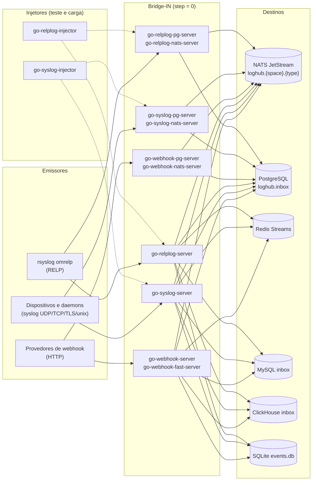

Todo servidor:

- gera um envelope **JLH** com `uuid` UUIDv7 e o horário `event` saídos da
  **mesma** amostra de relógio;
- tem uma identidade (`AGENT_UUID`, `WORKSPACE`...) resolvida pelo
  `go-loghub-ident` e guardada em `DATADIR`;
- expõe `/healthz`, `/readyz` e `/metrics` (Prometheus) numa porta admin
  ligada ao loopback;
- escreve tudo o que grava sob `DATADIR` (`/data` no contêiner): identidade,
  `ring.db`, `events.db` e `emergency/`;
- nunca cria tabela nem stream no destino. Só valida no boot e sai com código
  `3` se o esquema estiver errado.

---

## 3. Ring e sink: o modelo

Ring e sink são **dois eixos independentes**. Nenhuma implementação de ring
consulta o tipo do sink, e vice-versa.

- **Ring** é onde o evento espera entre ser aceito e ser entregue.
- **Sink** é o destino final.

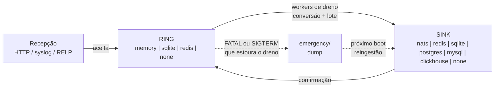

### Os rings

| Ring | Onde mora | O que a confirmação ao emissor significa | Perda em queda abrupta |
|---|---|---|---|
| `memory` | RAM do processo, com teto de itens e bytes | aceito na RAM | o backlog, mitigado pelo dump de emergência |
| `sqlite` | `ring.db` local, com `fsync` | gravado em disco | nada |
| `redis` (só syslog/RELP) | stream Redis **compartilhado** entre réplicas (`XAUTOCLAIM`) | gravado no Redis do ring | o que o Redis do ring perder |
| `none` | não há fila: a escrita no destino é síncrona | confirmado pelo destino | nada (a falha volta ao emissor) |

### Os sinks

| Sink | Destino | Observação |
|---|---|---|
| `nats` | NATS JetStream (`PubAck`); `core` opcional nos servidores syslog/RELP e no N | subject `loghub.{space}.{type}`; o JLH vai em `Data`; dedup por `Nats-Msg-Id` |
| `redis` | Redis Streams (`XADD`) | padrão da família webhook |
| `sqlite` | `events.db` local, append-only | nó único, sem infraestrutura |
| `postgres` | fila `loghub.inbox` (PostgreSQL 18) | DDL literal em `docker/postgres/inbox.sql` |
| `mysql` | tabela `inbox` que espelha a `loghub.inbox` | `docker/mysql/` |
| `clickhouse` | `ReplacingMergeTree` (`inbox` nos webhooks, `inbox_syslog` no syslog) | protocolo nativo, ClickHouse 25.8+ |
| `none` | descarte | **benchmark**: o boot avisa que não é para produção |

### O que "confirmar" significa em cada protocolo

| Protocolo | Confirmação | Ring cheio |
|---|---|---|
| HTTP (webhooks) | `200` com `X-LogHub-UUID`, só depois da garantia da combinação | `429` com `Retry-After` |
| syslog TCP/TLS | o servidor continua lendo | para de ler; a janela TCP segura o emissor |
| syslog unix datagram | não existe | descarte, mas o kernel já segurou o emissor |
| syslog UDP | não existe | **descarte contado** em métrica |
| RELP | `200 OK` por mensagem, só depois do ring | a transação é segurada; passado `relp.backpressure_timeout` a sessão fecha sem resposta e o rsyslog retransmite |

---

## 4. Topologias de ring e sink

### 4.1 Família webhook (`go-webhook-server`, `go-webhook-fast-server`)

São 21 combinações, de 3 rings × 7 sinks, e todas são válidas. Há um compose
para cada uma em `docker/compose.<ring>-<sink>.yml`.

**ring = memory** (padrão: `memory → redis`)

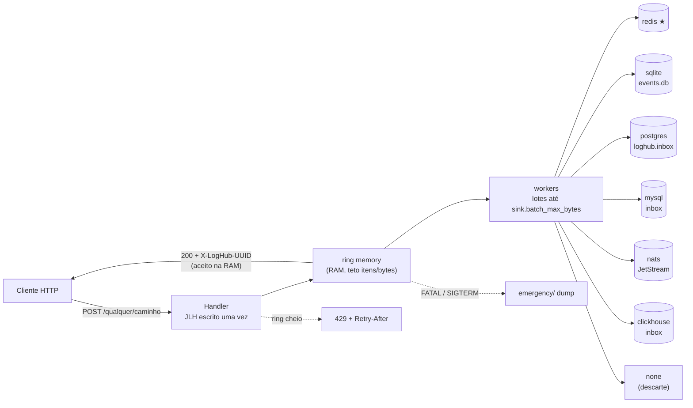

**ring = sqlite** (fila durável em disco)

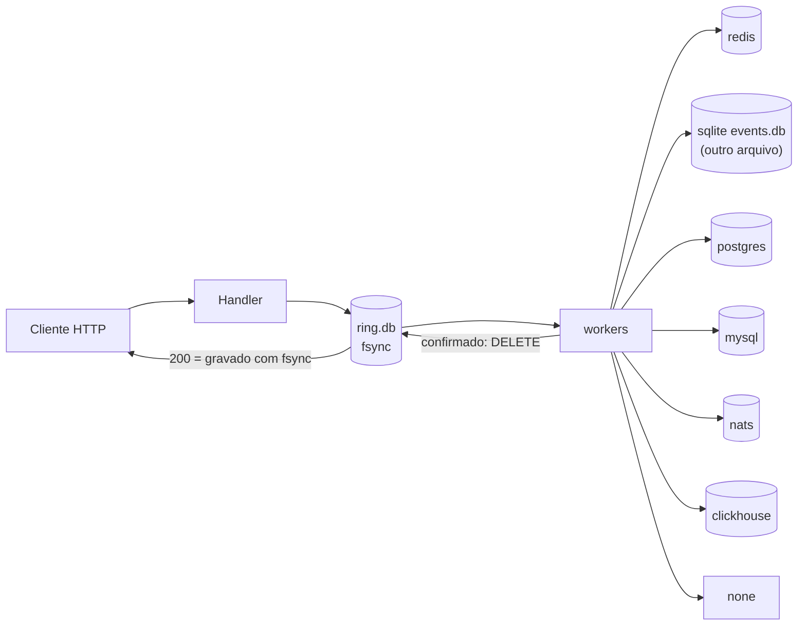

Com `sqlite → sqlite`, `ring.db` e `events.db` têm de ser arquivos diferentes;
o boot recusa o mesmo caminho. A combinação só compensa com os dois em discos
físicos diferentes.

**ring = none** (síncrono: o cliente sabe de cada falha)

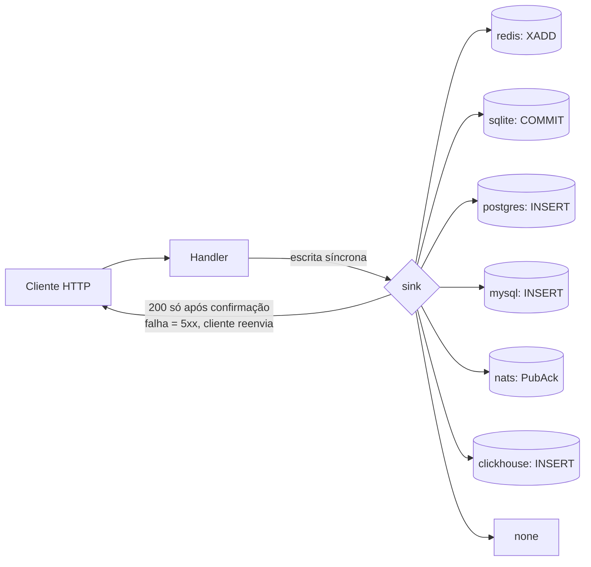

| Ring \ Sink | redis | sqlite | postgres | mysql | nats | clickhouse | none |
|---|---|---|---|---|---|---|---|
| **memory** | ★ padrão | nó único | banco compartilhado | banco compartilhado | barramento | analítico | benchmark |
| **sqlite** | sem perda, destino remoto | dois fsyncs | fila local + banco | fila local + banco | fila local + barramento | fila local + analítico | benchmark |
| **none** | cliente sabe da falha | cliente sabe da falha | cliente sabe da falha | cliente sabe da falha | cliente sabe da falha | só com `async_insert` | benchmark puro de HTTP |

### 4.2 Família syslog e RELP (`go-syslog-server`, `go-relplog-server`)

São 4 rings × 7 sinks. A única combinação recusada é `redis → redis`, que vira
`memory` com `WARN`: o ring não protegeria nada que o destino já não perca
junto. Os composes cobrem 23 combinações: os 21 de `memory`/`sqlite`/`none`
mais `redis-nats` e `redis-postgres`.

No ring o item é guardado **cru** (cabeçalho mais mensagem). A conversão para
JLH roda no dreno, e o JLH é função pura de cabeçalho, cru e config. Por isso
um retry reenvia os mesmos bytes, e réplicas que dividem um ring Redis
precisam da mesma config `[syslog]`.

**ring = memory** (padrão: `memory → nats`)

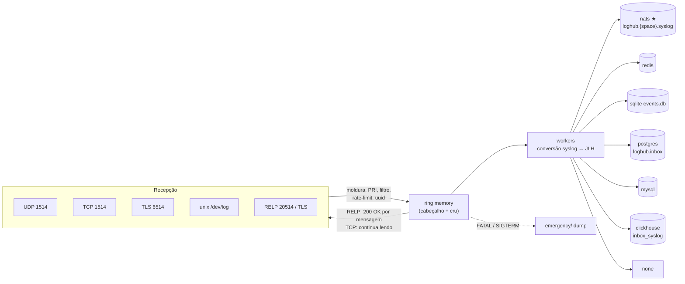

**ring = sqlite**

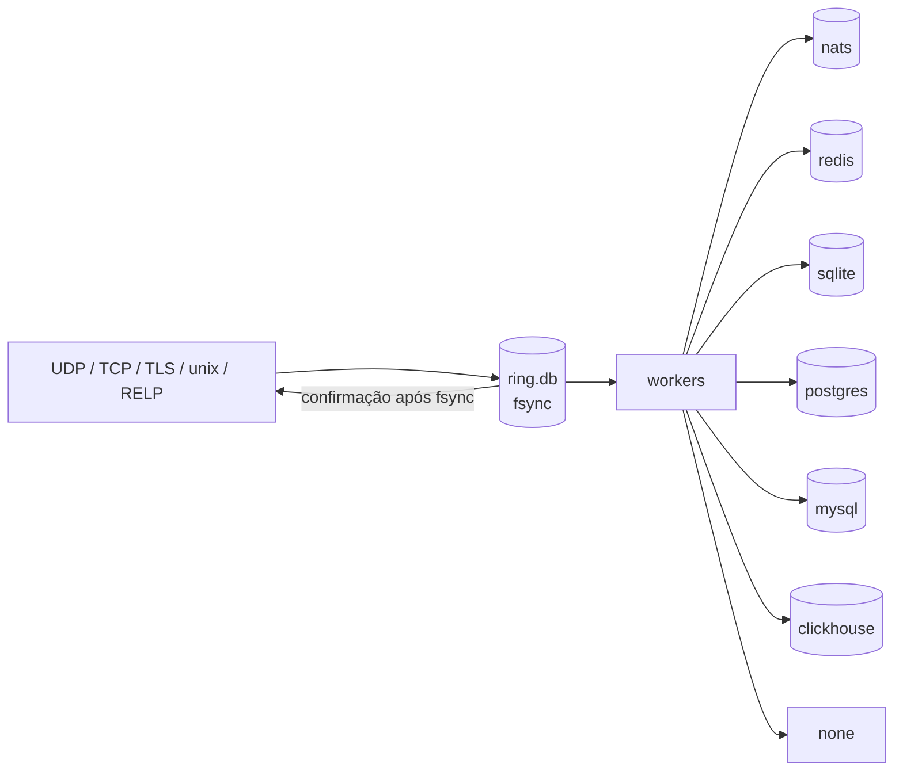

**ring = redis** (compartilhado entre réplicas)

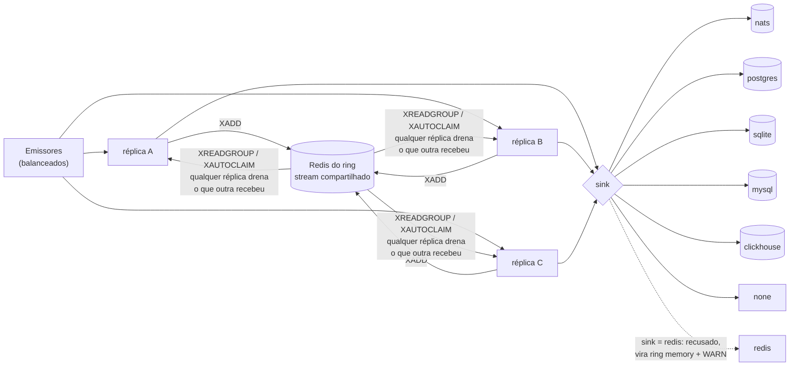

**ring = none**

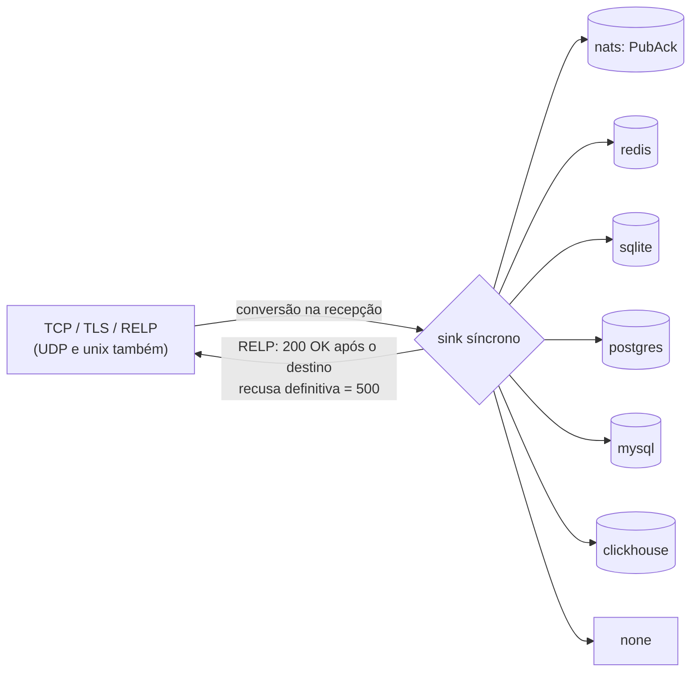

| Ring \ Sink | nats | redis | sqlite | postgres | mysql | clickhouse | none |
|---|---|---|---|---|---|---|---|
| **memory** | ★ padrão | sim | sim | sim | sim | sim | benchmark |
| **sqlite** | sim | sim | sim | sim | sim | sim | benchmark |
| **redis** | sim (compose) | **não** (vira memory) | sim | sim (compose) | sim | sim | benchmark |
| **none** | sim | sim | sim | sim | sim | sim | benchmark |

### 4.3 Cortes PostgreSQL (`go-webhook-pg-server`, `go-syslog-pg-server`, `go-relplog-pg-server`)

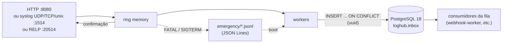

### 4.4 Cortes NATS (`go-webhook-nats-server`, `go-syslog-nats-server`, `go-relplog-nats-server`)

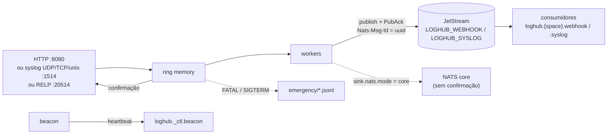

### 4.5 Injetores no laboratório

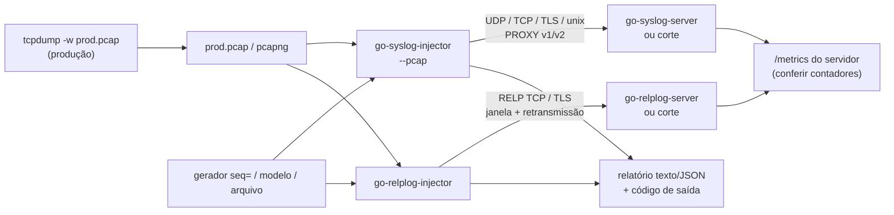

---

## 5. Como implementar cada sistema

### 5.1 Requisitos comuns

- **Go 1.25+**, só para compilar. Os binários não têm dependência de sistema.
- **Docker com Compose**, para as stacks de exemplo.
- Cada destino precisa de uma versão mínima: PostgreSQL 18, MySQL 8.4,
  ClickHouse 25.8, Redis 7 e NATS 2.11+ com JetStream. No Redis, a
  `maxmemory-policy` não pode ser `allkeys-*`.

Compilar qualquer módulo:

```bash
cd go-syslog-server
CGO_ENABLED=0 go build -tags osusergo,netgo -o go-syslog-server ./cmd/go-syslog-server
```

Ou instalar uma versão publicada:

```bash
go install github.com/patrickbrandao/loghub-paradise/go-syslog-server/cmd/go-syslog-server@v1.2.0
```

Também há binários prontos em cada [release](https://github.com/patrickbrandao/loghub-paradise/releases), com `SHA256SUMS`.

### 5.2 Configuração (vale para todos os servidores)

```
defaults  <  arquivo INI (--config)  <  ambiente  <  linha de comando
```

Cada parâmetro tem três formas equivalentes:

- flag: `--sink.type=postgres`;
- variável de ambiente: `<PREFIXO>_SINK_TYPE=postgres`;
- INI: `[sink]` seguido de `type = postgres`.

| Família | Prefixo do ambiente | Porta de recepção | Admin |
|---|---|---|---|
| webhook (W, F, P, N) | `WHS_` | `server.bind = :8080` | `127.0.0.1:9101` |
| syslog (S, SP, SN) | `SYSLOG_` (`[syslog]` usa `SYSLOG_<CHAVE>`) | UDP/TCP `:1514`; TLS `:6514` se ligado; unix opcional | `127.0.0.1:9102` |
| RELP (R, RP, RN) | `RELPLOG_` | `listen.tcp = :20514`; TLS `:20515` se ligado (só R) | `127.0.0.1:9103` |

Algumas variáveis têm nome fixado pelas skills do LogHub:

- `DATADIR` (`server.data_dir`);
- `LOGHUB_EB_URL` (`[loghub]`);
- a identidade: `AGENT_UUID`, `AGENT_NAME`, `WORKSPACE`, `HOSTNAME`,
  `MACHINE_ID`.

Comandos úteis:

```bash
./go-webhook-server --help          # todos os parâmetros, com padrão e variável
./go-webhook-server --dump-config   # a configuração efetiva (senhas mascaradas)
kill -HUP <pid>                     # recarrega as chaves recarregáveis (filtro, rate-limit, log...)
```

No macOS o `HOSTNAME` não pode ter `_`, ou o `go-loghub-ident` sai com um
código entre 100 e 114. Use, por exemplo, `HOSTNAME=dev-mac`.

### 5.3 Preparar o destino (o servidor nunca cria esquema)

| Sink | O que criar antes | Arquivo de referência |
|---|---|---|
| `postgres` | a fila `loghub.inbox` (DDL literal da skill) | `<módulo>/docker/postgres/inbox.sql` |
| `mysql` | a tabela `inbox`; o usuário precisa de `INSERT` e `UPDATE (uuid)` | `go-webhook-server/docker/mysql/inbox.sql`, `go-syslog-server/docker/mysql/schema.sql` |
| `clickhouse` | `inbox` (webhooks) ou `inbox_syslog` (syslog/RELP) | `<módulo>/docker/clickhouse/*.sql` |
| `nats` | o stream JetStream (`LOGHUB_WEBHOOK`, `LOGHUB_SYSLOG`) cobrindo `loghub.{space}.{type}` | `<módulo>/docker/nats/stream.json` |
| `redis`, `sqlite`, `none` | nada | — |

Por exemplo, para a fila do PostgreSQL:

```bash
psql "$DSN" -f go-syslog-server/docker/postgres/inbox.sql
```

Se o esquema estiver errado (coluna, índice, permissão, `max_payload`), o boot
sai com código `3`, em vez de descartar eventos depois.

### 5.4 go-webhook-server e go-webhook-fast-server

1. Escolha a combinação na [tabela 4.1](#41-família-webhook-go-webhook-server-go-webhook-fast-server).
   Escolha o **fast** quando o consumidor espera `type=webhook` e a resposta
   `{uuid, mode:"fast", status:"accepted", stage}`.
2. Prepare o destino ([5.3](#53-preparar-o-destino-o-servidor-nunca-cria-esquema)).
3. Configure os proxies confiáveis (`proxy.trusted`) antes de expor à
   internet. Sem isso, `X-Forwarded-For` é ignorado e o IP de origem é o do
   peer TCP.
4. Suba o servidor:

```bash
cd go-webhook-server/docker
docker compose up -d --build                              # memory -> redis
docker compose -f compose.memory-postgres.yml up -d --build
docker compose -f compose.sqlite-nats.yml up -d --build
```

Fora do Docker, com um nó único em SQLite:

```bash
HOSTNAME=dev-mac ./go-webhook-server --ring.mode=memory --sink.type=sqlite \
  --ring.data_dir=./data --server.bind=127.0.0.1:8080 --admin.bind=127.0.0.1:9101
```

Cada compose usa portas próprias, para que várias combinações rodem lado a
lado. A tabela está em `go-webhook-server/docker/README.md`.

### 5.5 go-webhook-pg-server e go-webhook-nats-server

O ring e o destino são fixos. Configure só a conexão:

```bash
# PostgreSQL
WHS_SINK_POSTGRES_ADDR=db:5432 WHS_SINK_POSTGRES_DATABASE=webhook \
WHS_SINK_POSTGRES_USERNAME=webhook WHS_SINK_POSTGRES_PASSWORD=*** \
DATADIR=/data ./go-webhook-pg-server

# NATS JetStream (stream LOGHUB_WEBHOOK)
WHS_SINK_NATS_URLS=nats://nats:4222 DATADIR=/data ./go-webhook-nats-server
```

Stacks prontas: `docker compose up -d --build` em `go-webhook-pg-server/docker`
e em `go-webhook-nats-server/docker`.

### 5.6 go-syslog-server

1. Escolha a combinação na [tabela 4.2](#42-família-syslog-e-relp-go-syslog-server-go-relplog-server).
   A padrão é `memory → nats`.
2. Ligue os transportes de que precisa:

   | Transporte | Como ligar |
   |---|---|
   | UDP | `listen.udp` |
   | TCP | `listen.tcp` |
   | TLS | `listen.tls` + `tls.cert_file`/`tls.key_file` |
   | unix datagram | `listen.unix=/dev/log` |

   Um endereço vazio desliga o transporte.
3. No contêiner o servidor escuta em `1514`. Publique a porta como
   `514:1514`.
4. Para várias réplicas sem perda, use `ring=redis`. Todas precisam da mesma
   config `[syslog]`, do mesmo `WORKSPACE` e da mesma versão.

```bash
cd go-syslog-server/docker
docker compose up -d --build                               # memory -> nats
docker compose -f compose.redis-postgres.yml up -d --build # ring compartilhado
```

Local, sem infraestrutura:

```bash
mkdir -p /tmp/sls-data
DATADIR=/tmp/sls-data AGENT_NAME=go-syslog-server HOSTNAME=dev-mac \
  ./go-syslog-server --sink.type=sqlite --listen.udp=127.0.0.1:1514 \
  --listen.tcp=127.0.0.1:1514 --admin.bind=127.0.0.1:9102
```

### 5.7 go-syslog-pg-server e go-syslog-nats-server

```bash
SYSLOG_SINK_POSTGRES_ADDR=db:5432 SYSLOG_SINK_POSTGRES_PASSWORD=*** DATADIR=/data ./go-syslog-pg-server
SYSLOG_SINK_NATS_URLS=nats://nats:4222 DATADIR=/data ./go-syslog-nats-server
```

Recebem UDP, TCP e unix, sem TLS. O `go-syslog-nats-server` também emite o
heartbeat em `loghub._ctl.beacon`. Há uma stack pronta em `docker/` de cada um.

### 5.8 go-relplog-server

1. Instale o `rsyslog-relp` nos emissores e configure o `omrelp` para o
   servidor (exemplo em [6.3](#63-go-relplog-server-e-cortes-relp)).
2. Escolha ring e destino como na família syslog. O RELP só confirma cada
   mensagem (`200 OK`) depois do ring.
3. Para TLS, defina `listen.tls` e os certificados (`docker/conf/tls`). O mTLS
   é opcional.

```bash
cd go-relplog-server/docker
docker compose up -d --build                          # memory -> nats
docker compose --profile demo -f compose.emitter.yml up -d   # emissor rsyslog de demonstração
```

Local:

```bash
mkdir -p /tmp/rls-data
DATADIR=/tmp/rls-data ./go-relplog-server --sink.type=sqlite --listen.tcp=127.0.0.1:20514
```

### 5.9 go-relplog-pg-server e go-relplog-nats-server

```bash
RELPLOG_SINK_POSTGRES_ADDR=db:5432 RELPLOG_SINK_POSTGRES_PASSWORD=*** DATADIR=/data ./go-relplog-pg-server
RELPLOG_SINK_NATS_URLS=nats://nats:4222 DATADIR=/data ./go-relplog-nats-server
```

O `docker compose up -d --build` de cada um sobe o servidor, o destino e um
emissor rsyslog.

### 5.10 Injetores

```bash
cd go-syslog-injector  && go build -o go-syslog-injector  ./cmd/go-syslog-injector
cd go-relplog-injector && go build -o go-relplog-injector ./cmd/go-relplog-injector
```

Não precisam de configuração nem de identidade: tudo vem das flags (`--help`).
Também há imagem em `docker/Dockerfile` de cada um. Para conferir a entrega,
compare o relatório do injetor com os contadores do `/metrics` do servidor.

### 5.11 Operação em produção

- **Saúde.** Use `/readyz` como readiness (reflete a saúde do destino e o
  enchimento do ring) e `/healthz` como liveness. As métricas ficam em
  `/metrics`, com os prefixos
  `whs_`, `syslog_` e `relplog_`.
- **Shutdown.** O `SIGTERM` drena o ring até o `drain_timeout`. O que não
  couber vai para o dump em `emergency/`, que é reingerido no próximo boot.
- **Contêiner.**
  - O binário fica em `/app` e a única área gravável é `/data`.
  - A configuração entra em `/etc/<serviço>:ro`.
  - Roda com uid `65532`, raiz somente leitura e sem capabilities.
- **Exit codes dos servidores.** `1` indica config inválida; `3` indica
  destino ou esquema recusado no boot. A lista completa está no
  `docker/README.md` de cada módulo.

---

## 6. Guia de exemplos

### 6.1 Família webhook

Enviar um evento:

```bash
curl -i -X POST http://127.0.0.1:8080/github/push \
  -H 'Content-Type: application/json' \
  -d '{"ref":"refs/heads/main","commits":3}'
# HTTP/1.1 200 OK
# X-LogHub-UUID: 01a1122b-8b69-73a4-b9d1-074a5fb34be2
```

No fast, o corpo da resposta diz onde o envelope estava ao confirmar:

```json
{"uuid":"01a1122b-8b69-73a4-b9d1-074a5fb34be2","mode":"fast","status":"accepted","stage":"ring"}
```

Qualquer método em maiúsculas é aceito. Só o `CONNECT` responde `405`:

```bash
curl -X PUT  http://127.0.0.1:8080/stripe/events --data-binary @evento.json
curl -X GET 'http://127.0.0.1:8080/ping?origem=monitor'
```

HTTP/2 em claro (h2c, por prior knowledge):

```bash
curl --http2-prior-knowledge -X POST http://127.0.0.1:8080/h2 -d 'oi'
```

Atrás de um proxy confiável (`proxy.trusted`), o IP de origem sai do
`X-Forwarded-For`:

```bash
curl -X POST http://127.0.0.1:8080/x -H 'X-Forwarded-For: 203.0.113.7' -d '{}'
```

Ver o resultado:

```bash
curl -s http://127.0.0.1:9101/readyz
curl -s http://127.0.0.1:9101/metrics | grep -E '^whs_(requests|events)'
redis-cli XRANGE loghub.<space>.webhook.request - + COUNT 1                    # sink=redis (W)
psql "$DSN" -c 'select uuid, type, space from loghub.inbox order by uuid desc limit 5'   # sink=postgres
nats stream view LOGHUB_WEBHOOK_REQUEST       # sink=nats (W; F e N: LOGHUB_WEBHOOK)
```

O stream é `loghub.{space}.{type}` por padrão. Os nomes de chave, stream e
tabela efetivos aparecem no `--dump-config`.

Uma carga simples sem ferramenta própria, com o `ab`:

```bash
ab -n 100000 -c 64 -p body.json -T application/json http://127.0.0.1:8080/carga
```

### 6.2 go-syslog-server e cortes syslog

Com ferramentas do sistema:

```bash
# UDP, RFC 5424
printf '<13>1 - - app - - - teste udp' | nc -u -w1 127.0.0.1 1514
# TCP, octet-counting
printf '17 <13>1 - - a - - - x' | nc -w1 127.0.0.1 1514
# TCP, com LF no fim
printf '<13>Oct 31 10:00:00 host app: teste tcp\n' | nc -w1 127.0.0.1 1514
# logger do util-linux (no Linux)
logger -n 127.0.0.1 -P 1514 -T --rfc5424 'teste via logger'
```

No rsyslog, para encaminhar tudo por TCP:

```
*.* action(type="omfwd" target="10.0.0.5" port="514" protocol="tcp"
           TCP_Framing="octet-counted" template="RSYSLOG_SyslogProtocol23Format")
```

Com o `go-syslog-injector`:

```bash
# 1 mensagem RFC 5424 por TCP
./go-syslog-injector --target 127.0.0.1:1514

# 100 000 mensagens o mais rápido possível, 8 conexões
./go-syslog-injector --target 127.0.0.1:1514 --count 100000 --concurrency 8

# carga: 60 s a 50 000 msg/s, mensagens de 512 bytes, relatório JSON
./go-syslog-injector --target 10.0.0.5:1514 --duration 60s --rate 50000 \
  --concurrency 8 --size 512 --report json > resultado.json

# UDP com modelo e severidade
./go-syslog-injector --transport udp --template 'login fail user={rand:6} id={uuid}' \
  --severity warning --count 100

# RFC 3164, moldura LF, facility local3
./go-syslog-injector --format 3164 --framing lf --facility local3 --count 1000

# TLS com mTLS e cabeçalho PROXY v2 anunciando outra origem
./go-syslog-injector --transport tls --target syslog.lab:6514 --tls-ca ca.crt \
  --tls-cert cli.crt --tls-key cli.key --proxy-protocol v2 --proxy-src 198.51.100.9:40000

# socket unix datagrama
./go-syslog-injector --transport unix --target /dev/log --count 500

# linhas de um arquivo, em laço por 5 minutos
./go-syslog-injector --file mensagens.txt --loop --duration 5m --rate 2000
cat app.log | ./go-syslog-injector --file - --format raw
```

Replay de uma captura de produção:

```bash
tcpdump -i eth0 -s 0 -B 65536 -U -w prod.pcap 'port 514'
./go-syslog-injector --target 127.0.0.1:1514 --pcap prod.pcap --pcap-port 514
./go-syslog-injector --target 127.0.0.1:1514 --pcap prod.pcap --pcap-timing original --pcap-speed 4
./go-syslog-injector --pcap prod.pcap --pcap-proto udp --transport udp
```

O mesmo vale para os cortes (`go-syslog-pg-server`, `go-syslog-nats-server`),
só sem TLS. Para conferir a entrega:

```bash
curl -s http://127.0.0.1:9102/metrics | grep -E '^syslog_(messages|events)_'
```

### 6.3 go-relplog-server e cortes RELP

No rsyslog (pacote `rsyslog-relp`):

```
module(load="omrelp")
action(type="omrelp" target="10.0.0.5" port="20514"
       queue.type="LinkedList" queue.size="100000"
       action.resumeRetryCount="-1")

# sobre TLS (só go-relplog-server)
action(type="omrelp" target="10.0.0.5" port="20515" tls="on"
       tls.caCert="/etc/rsyslog/ca.crt" tls.authMode="name"
       tls.permittedPeer=["relp.example"])
```

Com o `go-relplog-injector`:

```bash
# 1 mensagem, confirmada por 200 OK
./go-relplog-injector --target 127.0.0.1:20514

# carga: 60 s a 20 000 msg/s em 4 sessões, janela de 128 transações
./go-relplog-injector --target 10.0.0.5:20514 --duration 60s --rate 20000 \
  --concurrency 4 --size 512 --window 128

# TLS
./go-relplog-injector --target relp.example:20515 --transport tls --tls-ca ca.crt --count 1000

# resiliência: reinicie o servidor no meio; o injetor retransmite o que ficou
# sem resposta (até --retries) e o relatório conta retransmitted e serverclose
./go-relplog-injector --target 127.0.0.1:20514 --count 200000 --retries 10

# um 500 encerra a sessão, como no librelp; continue para seguir em outra
./go-relplog-injector --target 127.0.0.1:20514 --count 10000 --on-reject continue

# replay de RELP (ou syslog TCP/UDP) capturado
./go-relplog-injector --target 127.0.0.1:20514 --pcap relp.pcap --pcap-timing original
```

Ver o resultado:

```bash
curl -s http://127.0.0.1:9103/metrics | grep -E '^relplog_(relp_responses|messages_accepted|events_written|relp_unanswered)_total'
```

### 6.4 go-syslog-standard-server

É a referência antiga, sem envelope LogHub. O uso é igual ao do syslog,
inclusive com RELP:

```bash
cd go-syslog-standard-server/docker && docker compose up -d --build   # memory -> redis
printf '<13>1 - - app - - - teste' | nc -u -w1 127.0.0.1 1514
```

### 6.5 Receitas de teste de carga

| Objetivo | Receita |
|---|---|
| Teto da máquina | servidor com `ring=none sink=none` + injetor sem `--rate` |
| Custo do ring | `ring=memory sink=none`, compare com o anterior |
| Custo do destino | `ring=memory sink=<real>`, compare com o anterior |
| Perda em UDP | injetor UDP com `--rate` crescente; compare o `seq` recebido com o `syslog_messages_dropped_total` |
| Retransmissão RELP | `go-relplog-injector --count N` e reinicie o servidor no meio |
| Tráfego real | `tcpdump` em produção + `--pcap ... --pcap-timing original` no laboratório |

---

## 7. Versões e releases

- **Tags por módulo:** `<módulo>/vX.Y.Z`, por exemplo
  `go-syslog-server/v1.2.0`.
- **Release do repositório:** `vAAAA.MM.DD`, com os binários CGO-free de
  linux/darwin amd64/arm64 e o `SHA256SUMS`.
- **Histórico:** [`CHANGELOG.md`](CHANGELOG.md) registra cada rodada, com
  defeitos, correções, decisões e o que ficou "a portar" entre módulos irmãos.
- **Agentes de IA:** cada módulo tem um `AGENTS.md` com o mapa do código, as
  armadilhas conhecidas e os comandos de teste.
